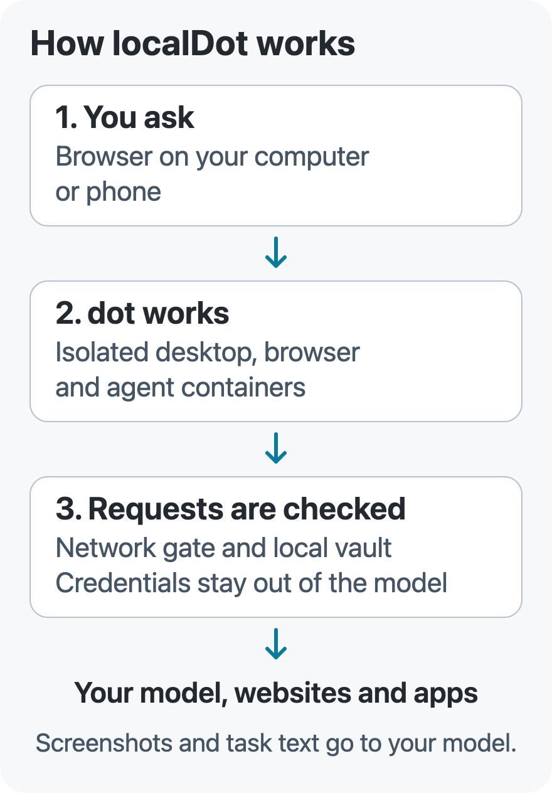
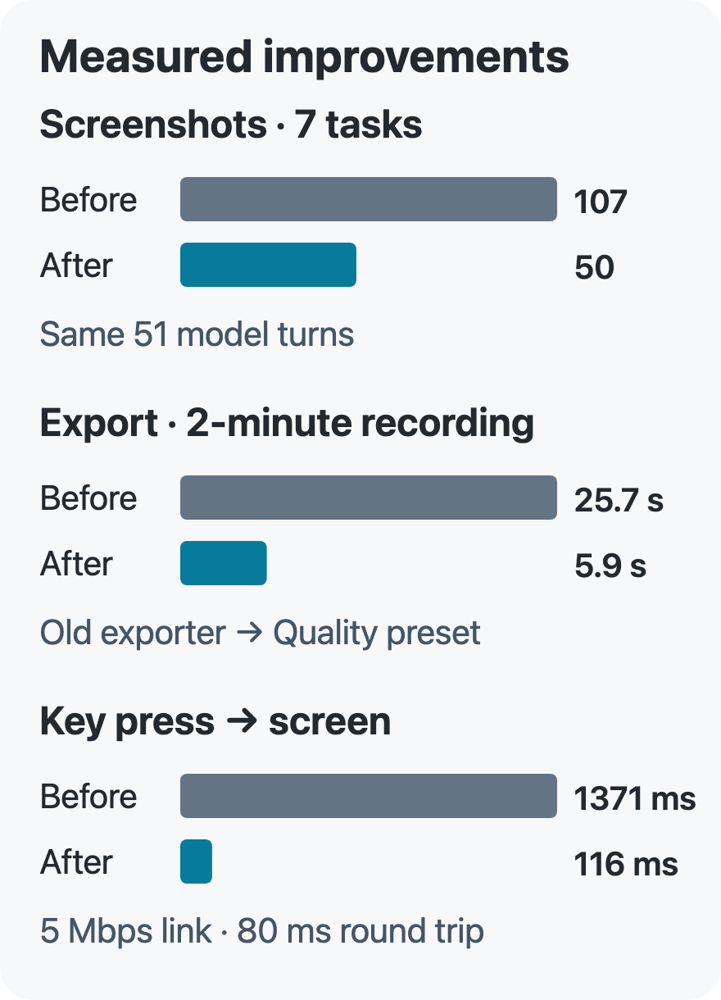

<p align="center">
  
</p>

<h1 align="center">localDot</h1>

<p align="center">
  An assistant with its own computer. Runs locally. Watch it work from your browser or phone.
</p>

<p align="center">
  <a href="LICENSE">MIT licensed</a> · Alpha · macOS, Linux and Windows (WSL 2)
</p>

## Install

**1. Start Docker.** You need Docker Engine 28 or newer, git, curl and about **15 GB** of free
space. Use Docker Desktop on macOS; on Windows, enable its WSL integration. Linux needs systemd
and Docker access for your user. [Full requirements](docs/install.md#what-you-need).

**2. Run the installer.**

macOS or Linux — in Terminal, as your normal user:

```sh
curl -fsSL https://raw.githubusercontent.com/Shadowhusky/localdot/main/install.sh | bash
```

Windows — in PowerShell:

```powershell
irm https://raw.githubusercontent.com/Shadowhusky/localdot/main/install.ps1 | iex
```

The Windows installer sets up WSL 2 and Ubuntu. If it asks you to restart Windows, run the same
command again afterward. The first installation builds the computer images and usually takes
**10–30 minutes**. Node.js and Go are installed for localDot automatically.

**3. Open the sign-in link** printed by the installer. Choose a model, add your key or supported
plan sign-in, then turn on dot's computer and send a task. To open the app again, run `localdot open`.

[Installation help](docs/install.md) · [Use your phone or a server](docs/install.md#servers-without-a-screen) ·
[Run from source](docs/development.md#development)

## See it work

<picture>
    <source media="(max-width: 600px)" srcset="docs/readme/watch-mobile.png">
    
  </picture>

*Actual app, sample data. On phones, this shows the phone layout. [Open the desktop screenshot](docs/readme/watch.png).*

dot clicks, types, browses, writes code and works with files inside an isolated Linux computer
on your machine. You watch its screen live, follow its steps, and take control whenever you need.

- **Visible work.** Commands and file changes appear in an Activity window inside the computer.
  Steps, Files and Sources show what happened; recordings let you replay it later.
- **Your choice of model.** Use provider APIs, supported subscription plans or a local model.
  Configured models stay available together, grouped by provider.
- **Apps and research.** Connect apps through MCP, search the web, or turn on Research for a
  report with numbered sources.
- **Memory and routines.** Reuse relevant setup experience across conversations and scheduled
  tasks. Inspect, edit or delete what dot remembers in Settings.
- **Private credentials.** API keys stay in a local vault. Supported website passwords use
  private forms and stay out of model input and conversation logs.

[Take the product tour](docs/tour.md) for voice, saved sign-ins, file previews, replay and more.

## Stay in control

**Stop** ends the current run and frees the conversation without shutting down the computer.
Start typing while dot works and the button becomes **Send**: your message waits for the task
to finish. Choose **Steer now** to deliver a queued message immediately.

<a href="docs/readme/queue.png"></a>

**Take control** gives you the mouse and keyboard. dot waits, and that stretch is not recorded.
Send a new message or choose **Hand back** when you want it to continue. New conversations reuse
the same computer. Panel sizes and visibility are remembered in your browser; Steps and Files
follow the selected conversation through reconnects.

The shield in the composer selects a permission mode:

- **Custom** follows your tool and autonomy settings. The default Balanced preset asks before
  sending as you, paying, uploading files or changing accounts.
- **Auto** lets Jev review routine actions and asks you when it cannot approve them.
- **Full access** skips routine confirmations; destructive actions still ask.

Network isolation and private credential handling apply in every mode.
[More about permissions and sign-ins](docs/tour.md#permissions-and-sign-ins).

## How it works

<picture>
    <source srcset="docs/readme/architecture-compact.svg" type="image/svg+xml">
    
  </picture>

[Open the diagram](docs/readme/architecture-compact.svg).

The local daemon serves the app and coordinates tasks. Desktop, browser and agent containers
have separate roles; a network gate controls their outbound connections. The local key service,
**keyd**, adds real API keys only for their allowed hosts. The agent receives stand-ins.

“Runs locally” does not mean everything stays offline: **screenshots and task text go to your
chosen model provider**, and online tasks contact websites and connected apps. With a local
model, model calls stay on your machine. dot sees host files when you attach them; the app also
stores recordings, settings and credentials locally.

[Credential storage](docs/install.md#saved-keys-and-logins) ·
[Browser isolation](docs/browser-workspace.md) · [Developer guide](docs/development.md)

## Models and cost

Choose models in **Settings → Models**, then switch from the composer. localDot supports major
API providers, OpenAI-compatible and Anthropic-compatible endpoints, and local servers such as
Ollama or LM Studio. The main model needs screenshot understanding and computer-use capability.

Claude Code can use your existing installation and plan. ChatGPT-plan support is limited to
Apple silicon builds with the required native and real-account acceptance recorded; it uses a
separate Codex home. [Model setup and limitations](docs/tour.md#models).

localDot is free. Your model provider charges for its usage. **Turn metadata** shows model,
tokens and cost, with estimates marked; spending limits are optional. If a task hits a model or
credit limit, choose another configured model and **Continue**.

## Performance

Measured on one M3 Ultra with sample data; results vary by machine, network and model.

<picture>
    <source srcset="docs/readme/performance-compact.svg" type="image/svg+xml">
    
  </picture>

- **Screenshots:** 107 → 50 across seven desktop tasks, with the same 51 model turns.
- **Export:** 25.7 s → 5.9 s for a two-minute recording. The old exporter used 1080p/30 fps;
  the new Quality preset used 2560×1600/60 fps.
- **Response:** 1371 ms → 116 ms median key-to-screen latency on a 5 Mbps, 80 ms link.

[Open the chart](docs/readme/performance-compact.svg) ·
[Full measurements and methodology](docs/measurements/2026-10-readme-numbers.md).

## Updates and help

Installed copies check for updates automatically and can download them in the background.
A dismissed notice stays available in **Settings → Your computer → Software update**. Installation
asks before shutting down the computer and restarting localDot. Existing installations need one
manual `localdot update` to enable automatic checks. [Update details](docs/install.md#automatic-updates).

- **Open:** `localdot open`
- **Update manually:** `localdot update`
- **Diagnose a problem:** `localdot doctor`
- **Uninstall:** `localdot uninstall` — keeps your data in `~/.localdot`.

For remote access, use a private Tailscale connection or SSH tunnel. Keep the service off the
public internet. [Phone and server setup](docs/install.md#servers-without-a-screen).

## Contributing

Bug reports and pull requests are welcome. See the [development guide](docs/development.md)
for setup and checks. Skills use `SKILL.md` folders, memory is editable Markdown, and connectors
use MCP.

## Licence

[MIT](LICENSE). [Third-party notices](THIRD-PARTY.md). The optional pencil diagrams use Kalam
under the [SIL Open Font License](docs/diagrams/fonts/OFL.txt).
