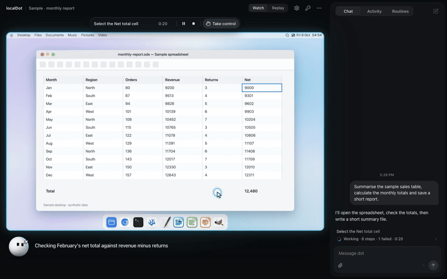

<p align="center">
  
</p>

<h1 align="center">localDot</h1>

<p align="center">
  <b>An assistant with its own computer. It lives on your Mac, and you can watch it work.</b>
</p>

<p align="center">
  <a href="LICENSE"></a>
  
  
</p>

<p align="center">
  
</p>
<p align="center">
  <sub>Twenty seconds of a sample task: dot works through a spreadsheet, stops to ask before
  sending anything as you, then hands over the files. <a href="docs/readme/tour.mp4">MP4 version</a>.</sub>
</p>

## What it is

localDot is an assistant that does real work on a computer. It clicks, types, drags, reads web
pages and runs code. It just doesn't do any of that on *your* computer.

dot (that's the assistant) gets a small, isolated computer of its own. It runs in containers on
your Mac, and you watch it live in a browser tab or on your phone. You can take over at any
moment, and every task is recorded, so you can scrub back through it later.

Think of it as giving a new assistant their own desk, rather than your laptop and your passwords.

Three things we cared about most:

- **You can see everything.** The live screen, a one-line note from dot on what it's doing and
  why, and a full list of every step, including the ones that failed.
- **Your keys never reach the model.** The agent only ever holds stand-ins. A small key service
  on your Mac adds the real key on the way out, and only for the hosts that key belongs to.
- **Nothing leaves without a reason.** All traffic goes through one gate. Sending as you, paying,
  passwords and uploads always ask first. Ordinary work on its own computer just runs.

## A quick tour

> The screens below come from a test build with sample data. No real accounts were harmed.

### Watch


The picture is dot's computer, live. The island on top says what's happening and keeps Pause,
Stop and Take control within reach. dot sits under the picture and tells you what it's doing in
plain words. The chat is on the right, and you can type into it while dot works.

### Activity


The plan, every step with what it did and how long it took (failures and blocked requests
included), and the files it changed. If something went sideways, this is where you find out
which step, and why.

### It asks, right where you are


Sending as you, paying, passwords, uploads and account changes stop and ask. The card says
exactly what will happen, and your answer can cover just this once, the whole task, the site, or
always. Clicking around on its own computer doesn't ask. Nobody wants to approve thirty clicks an
hour.


When dot needs a sign-in, the form shows up in the chat (or as a sheet on your phone). You type
the password, localDot puts it into the page, and the model never sees it.

### Take over any time


Press **Take control** and the computer is yours: mouse, keyboard, paste, the lot. dot can't see
or touch anything until you hand it back, and that stretch isn't recorded. Full screen is one
click away when you want the whole display.

### On your phone


Same app, laid out for a thumb. Put localDot on your tailnet and it works from anywhere, and it
will nudge your phone when dot needs you.

### Replay and export


Every task is recorded locally. Scrub through it, compare before and after for any step, skip
the idle bits. Export trims to the part you want and comes with presets: **Quality**, **Fast**
(small and quick) and **Showcase**, which puts dot and its lines into the video. Exports run on
your Mac, so closing the tab doesn't cancel them.

### What it made


When dot finishes you get the files with previews (images, PDFs, HTML in a sandbox, text, code,
CSV and spreadsheets, audio and video), a before and after screenshot as proof of work, and
**Revise** for when it's nearly right. Revised files keep their versions, with Compare.

### Routines


Checking the same three sites every weekday at 8:30? dot can offer to turn a task into a routine,
or you can write one yourself. Routines run while localDot is running, with the same checks, and
you choose what happens when you're away.

### First run and Settings


Setup walks you through a model, a key or a sign-in, how careful dot should be, and turning the
computer on. It takes about two minutes and you can skip it.


Settings has the rest: models, autonomy, the things you've always allowed, spending limits (off
until you want them), what dot remembers about you (all of it editable and deletable), the sites
you're signed in to, and your keys.

### The computer itself


It's Linux in containers, dressed to feel familiar: menu bar, dock, a launcher, traffic lights.
It comes with Chromium, LibreOffice, GIMP, a code editor and a terminal. Sign-ins in its web
browser stay put across restarts and new tasks, so you log in once.


## Meet dot

<p align="center">
  
</p>

dot is the little white ball doing the work, and it picks up whatever the job needs. A keyboard
when it types, a terminal when it runs code, a magnifier when it looks closely, a paper plane
when something is going out. It glides from one to the next, waves when it needs you, and
squints happily when it's done. It has no other hobbies.


## How it works

<picture>
  <source srcset="docs/readme/system.svg" type="image/svg+xml">
  
</picture>

| Part | What it does |
| --- | --- |
| **Daemon** | The app itself, on your Mac (TypeScript on Node). Serves the web UI, runs tasks, streams the picture, records everything, and decides what needs your OK. |
| **Desktop** | The screen you watch: a Linux desktop streamed as H.264. dot clicks, types and drags here. |
| **Web browser** | A separate browser that keeps your sign-ins. The desktop can't read its cookies. |
| **Brain** | The agent loop that talks to the model. It holds stand-in keys only. |
| **Gate** | The only way out to the network. No LAN, no router, no cloud metadata. |
| **keyd** | A small Go service that keeps your real keys (in the macOS Keychain, your Linux keyring or an encrypted file) and swaps them in at the edge. |

<picture>
  <source srcset="docs/readme/task-loop.svg" type="image/svg+xml">
  
</picture>

A task goes round a simple loop: act, take a fresh look at the screen, say what happened, repeat.
dot can batch several actions into one turn and find buttons by name instead of hunting for
pixels, which is a big part of why it got quicker (see the numbers below).

## Safety

<picture>
  <source srcset="docs/readme/safety.svg" type="image/svg+xml">
  
</picture>

What asks and what doesn't, on the default **Balanced** setting:

| dot wants to… | What happens |
| --- | --- |
| Click, type, scroll or drag on its own computer | Just runs |
| Open pages, read, search | Just runs |
| Run code or a terminal command on its own computer | Just runs |
| Send a message or email as you, or post as you | Asks first |
| Pay for or buy something | Asks first |
| Enter a password or another secret | Asks you to type it; the model never sees it |
| Upload your files somewhere | Asks first |
| Change account settings or delete data on a remote service | Asks first |
| Send private data somewhere unrelated to the task | Asks first, when the purpose check is on |
| Reach your LAN, your router or cloud metadata | Blocked |
| Use an API key | Gets a stand-in; the real key is added at the edge, for that key's hosts only |

**Careful** mode asks before every step except reading and browsing. Either way, your answer
can be scoped: just this once, for this task, for this site, or always, and you can take an
"always" back in Settings.

The purpose check is optional and recommended. It looks at where data is going (the host, the
size and shape of what's being sent, whether it overlaps private text dot has seen), never at the
private content itself, and it only asks when something private is heading somewhere the task
has no business going.

## Numbers

All measured on one Mac Studio (M3 Ultra) with sample data. Your Mac, your network and your model
will give different numbers. They're here to show the direction, not to win an argument. The
details are in [docs/measurements/2026-10-readme-numbers.md](docs/measurements/2026-10-readme-numbers.md).

<picture>
  <source srcset="docs/readme/chart-screenshots.svg" type="image/svg+xml">
  
</picture>

<picture>
  <source srcset="docs/readme/chart-export.svg" type="image/svg+xml">
  
</picture>

<picture>
  <source srcset="docs/readme/chart-stream.svg" type="image/svg+xml">
  
</picture>

| What | Before | After |
| --- | --- | --- |
| Screenshots sent to the model, 7 desktop tasks | 107 | 50 |
| Model turns to fill in a web form | 8 | 3 |
| Export a 2-minute recording, Quality (2560×1600, 60 fps) | 25.7 s (old exporter, 1080p 30 fps) | 5.9 s, 13.1 MB |
| Export a 2-minute recording, Fast (1280×800, 15 fps) | | 1.4 s, 1.7 MB |
| New frames per second on a 5 Mbps, 80 ms link | 10.9 | 57.3 |
| Key press to screen while scrolling, same link (median) | 1371 ms | 116 ms |
| First frame after a page reload | | 214 ms (Chrome), 209 ms (WebKit) |

## Models

dot needs a main model that can use a computer, meaning it can look at a screenshot and point at
things. A fast model for titles and quick checks is optional, and so is a local one.

| Kind | Options | Good to know |
| --- | --- | --- |
| API keys | Anthropic, OpenAI, Google Gemini, Azure OpenAI, xAI, Mistral, DeepSeek, Groq, OpenRouter, Together, Fireworks, Cerebras, Perplexity, Cohere, DeepInfra, Moonshot (Kimi), Alibaba (Qwen), Z.ai, Zhipu AI, MiniMax, Volcengine Ark, SiliconFlow | Keys live in keyd on your Mac. Prices come from the models.dev catalogue. |
| ChatGPT plan | Sign in with a code, runs through Codex | Apple silicon Macs. localDot keeps its own Codex home, separate from yours. |
| Claude Code (your plan) | Your own installed Claude Code | Uses your plan's limits. localDot never touches your Claude sign-in, settings or memory files. Off until you choose it. |
| Coding and token plans | MiniMax Token Plan, Alibaba Token Plan, Alibaba Coding Plan | Some vendors only allow their coding plans inside the coding tools they list (GLM Coding Plan, Kimi For Coding, Ark Coding Plan). For those, use the vendor's API key instead. |
| Your own endpoint | Any OpenAI-compatible or Anthropic-compatible base URL | You give it the model ID, what the model can do and what it costs. |
| On your Mac | LM Studio, Ollama | No key, no bill, and the model calls never leave your Mac. |

## Install

localDot runs on macOS, Linux and Windows (through WSL 2). dot's computer is Linux containers
everywhere, so every platform runs the same one. You'll need Docker (Engine 28 or newer), git,
curl and about 15 GB of disk. The installer brings its own Node.js and Go, installs nothing
system-wide and never asks for sudo.

**macOS** (Apple silicon or Intel, with Docker Desktop) and **Linux** (x86-64 or ARM64 with
systemd, such as Ubuntu, Debian or Fedora), as your own user:

```sh
curl -fsSL https://raw.githubusercontent.com/Shadowhusky/localdot/main/install.sh | bash
```

**Windows 10 (2004 or newer) or 11**, in PowerShell:

```powershell
irm https://raw.githubusercontent.com/Shadowhusky/localdot/main/install.ps1 | iex
```

It turns on WSL 2 (Windows wants a restart for that, then run it again), installs Ubuntu if it
isn't there, turns on systemd and runs the same installer inside it. Your Windows browser reaches
localDot at `http://127.0.0.1:4750`, as if WSL weren't there at all.

The first run builds dot's computer, which takes 10 to 30 minutes; put the kettle on. Then it
starts localDot as your own user's services and prints a one-time sign-in link. Open it, follow
the setup and turn the computer on. If something is missing, the installer lists all of it up
front, with the commands to fix it, rather than one complaint at a time.

- **Upgrade:** `localdot update`, or run the installer again. Settings and data stay put.
- **Uninstall:** `localdot uninstall`. It keeps your data in `~/.localdot` and prints the commands
  that delete it, for when you really mean it.
- **Something looks off:** `localdot doctor` checks Docker, the images, the key service and the
  app.

**On a server with no screen:** give it a regular user with Docker access and lingering turned
on (the [install guide](docs/install.md#preparing-a-fresh-server) has the four commands), sign
in as that user over SSH and run the same `curl` line. localDot runs as systemd user services,
so it keeps going after you log out. Your keys go in an encrypted file there; if a passphrase
protects it, run `localdot unlock` after the server restarts.

### Reaching it from another device

localDot only listens on `127.0.0.1`, so nothing on your network can reach it directly. Keep it
that way: don't forward its port or put it on the public internet. There are two safe ways in.

- **SSH tunnel**, from your own computer: `ssh -N -L 4750:127.0.0.1:4750 you@your-server`. Run
  `localdot open` on the server and open the link on your computer within a minute. Keep the
  same port on both ends; localDot only answers to its own address.
- **Tailscale**, for your phone and everything else you own: install with
  `curl -fsSL https://raw.githubusercontent.com/Shadowhusky/localdot/main/install.sh | bash -s -- --tailscale`,
  or run `localdot update --tailscale`, once MagicDNS and HTTPS certificates are on in your
  tailnet. localDot gets an HTTPS address that only your own devices can reach, and
  `localdot open --qr` draws the sign-in link as a QR code for your phone. It never uses Tailscale Funnel, and neither should you for this port: that would
  publish localDot to the whole internet.

Everything else, from installer options and where things live to how your saved keys are kept,
is in [Installing localDot](docs/install.md). To build and run from source instead, see
[docs/development.md](docs/development.md).

## FAQ

**Does it touch my real computer?**
No. dot works on its own computer, in containers. It sees your files only when you attach them,
and its results open on your Mac only when you click Open.

**Could it email my boss without asking?**
No. Sending as you always needs your OK, and the card shows exactly what's going out. Your boss
remains blissfully unaware.

**What does it cost?**
localDot is free and MIT licensed. Models cost whatever your provider charges, and localDot shows
what each task spent. Spending limits are there when you want them, and off until you do.

**Where does my data go?**
Screenshots and the task's text go to the model provider you chose, and dot visits the sites the
task needs. Pick a local model and the model calls stay on your Mac.

**Why is it called dot?**
Look at it.

**Can I build on it?**
Yes. Skills are plain `SKILL.md` folders, and dot's memory is two Markdown files you can read and
edit. See [docs/development.md](docs/development.md).

## Contributing

Bug reports, ideas and pull requests are welcome. Building, testing and running from source are
covered in [docs/development.md](docs/development.md). Before sending a change, run
`pnpm typecheck`, `pnpm lint`, the tests for what you touched, and `pnpm hygiene` (it scans for
anything that looks like a key).

## Licence

[MIT](LICENSE). Third-party notices are in [THIRD-PARTY.md](THIRD-PARTY.md). The handwriting in
the diagrams is Kalam, under the SIL Open Font License
([docs/diagrams/fonts/OFL.txt](docs/diagrams/fonts/OFL.txt)).
