<p align="center">
  
</p>

<h1 align="center">localDot</h1>

<p align="center">
  <b>An assistant with its own computer. It runs locally, and you can watch it work.</b>
</p>

<p align="center">
  <a href="LICENSE"></a>
  
  
</p>

<p align="center">
  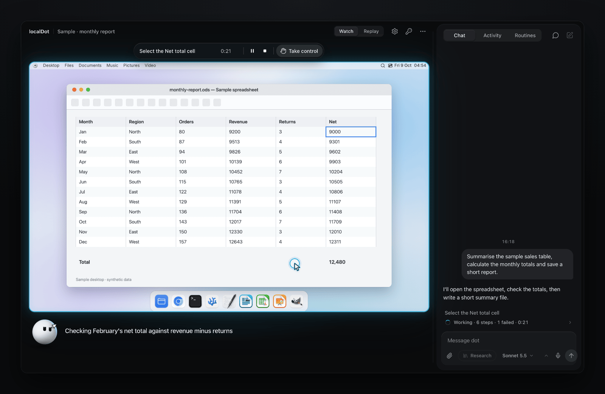
</p>
<p align="center">
  <sub>The current UI with sample data. Watch dot work, queue the next message or take control.</sub>
</p>

## What it is

localDot is an assistant that does real work on a computer. It clicks, types, drags, searches
the web, reads pages, runs code and uses your apps. It just doesn't do any of that on *your*
computer.

dot (that's the assistant) gets a small, isolated computer of its own. It runs in containers on
your machine, and you watch it live in a browser tab or on your phone. You can take over at any
moment, and every task is recorded, so you can scrub back through it later.

Think of it as giving an assistant their own desk, with credentials kept in a separate local vault.

Three things we cared about most:

- **You can see everything.** The live screen, a one-line note from dot on what it's doing and
  why, and a full list of every step, including the ones that failed.
- **Your keys never reach the model.** The agent only ever holds stand-ins. A small key service
  on your Mac adds the real key on the way out, and only for the hosts that key belongs to.
- **Nothing leaves without a reason.** Everything dot sends out passes one checkpoint on your Mac.
  Your permission mode decides what needs confirmation. Passwords use a private input path;
  API keys stay in the key service. Ordinary work on its own computer can just run.

## What dot can do

<picture>
  <source srcset="docs/readme/capabilities.svg" type="image/svg+xml">
  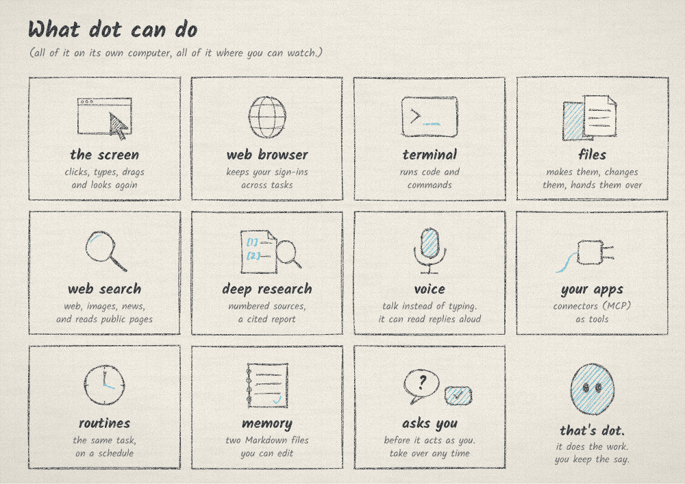
</picture>

The tour below shows them at work.

## A quick tour

> The screens below come from a test build with sample data. No real accounts were harmed.

### Watch


The picture is dot's computer, live. The island keeps **Stop** and **Take control** within
reach. dot sits under the picture and tells you what it's doing. The chat is on the right;
its controls stay on one row as you narrow the panel. Research has one toggle; the message menu
appears only when there is a choice of when to send. Use **Panels** in the top bar to hide or
restore Chat and Activity; the Activity close button hides its Steps, Files, and Sources view.
Panel sizes, visibility, and selected tabs are remembered in this browser across visits.

Background commands and file changes appear in a read-only **Activity** window inside dot's
computer, visible through the same live screen. It uses existing redacted output, without extra
model calls or command execution. The window clears before visual actions or handing control to you.

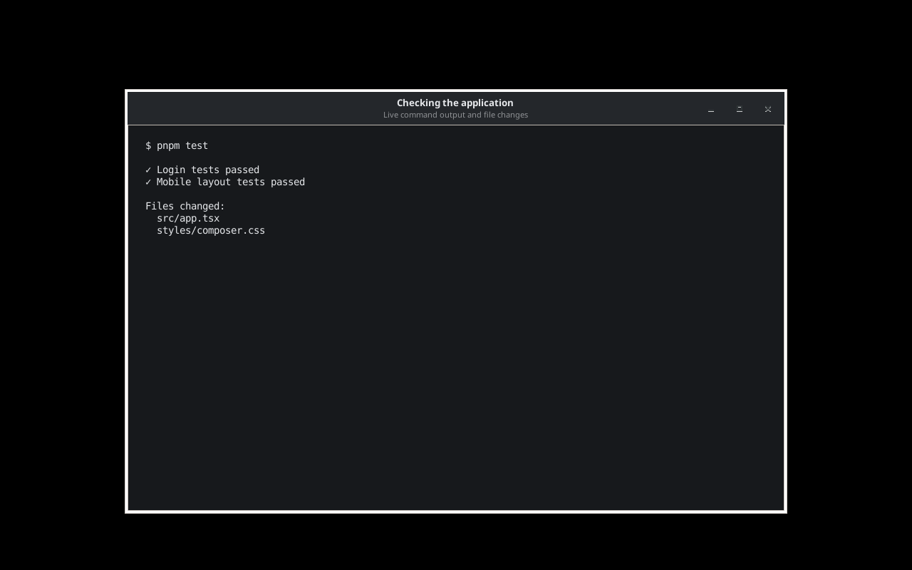

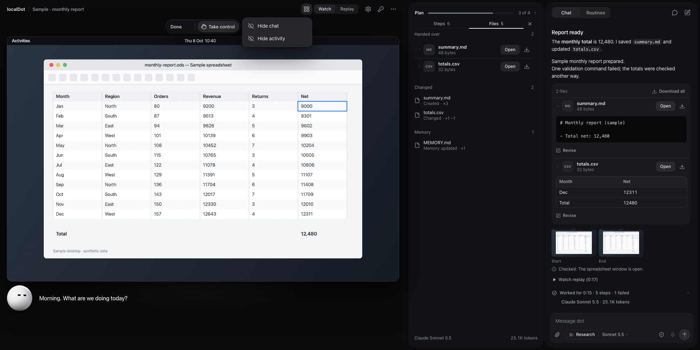

With an empty message box, the main button is **Stop**. Stopping ends the current run and releases
it so you can start a new conversation on the same running computer. Start typing and that button
becomes **Send**: while dot works, your message waits until the current task finishes. Choose **Steer now** on a queued
message to deliver it immediately. Stopping also cancels messages still waiting in the queue.

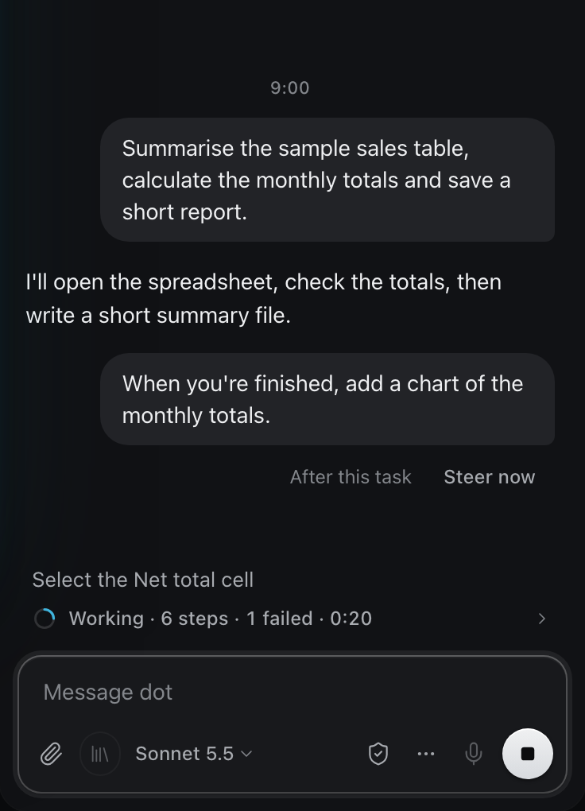

The timer uses localDot's own clock, including after the tab has been in the background. Earlier
conversations are searchable and grouped by day. You can read them while you hold computer control,
and starting a new conversation keeps the previous one out of the new thread. Each conversation
has an actions menu with Delete. Sending a message while you hold control hands it back to dot
and delivers your instruction.

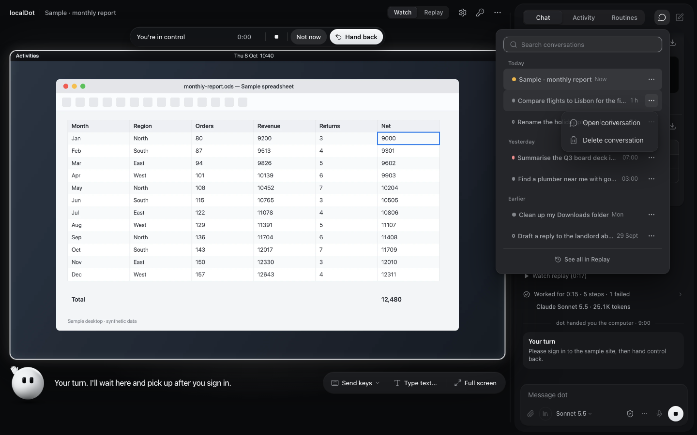

### Activity

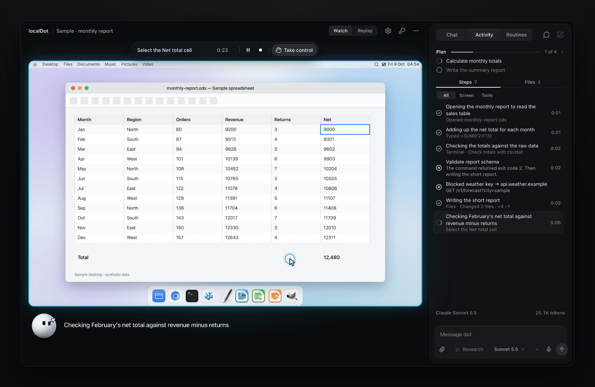

The plan sits on top as a slim strip: how far along it is, what dot is doing now and what comes
next. Tap it for the whole plan. Under it, **Steps** lists everything dot did and how long it
took, failures and blocked requests included. **Files** has what it changed, and research tasks
get **Sources**. One quiet line at the bottom shows the model and the tokens so far, plus the
money when you pay per call. If something went sideways, this is where you find out which step,
and why.

The panels are yours to size. Drag the edge between the picture and the side panel, double-click
it to reset, or focus it and use the arrow keys. localDot remembers the width.

### Search, read and research

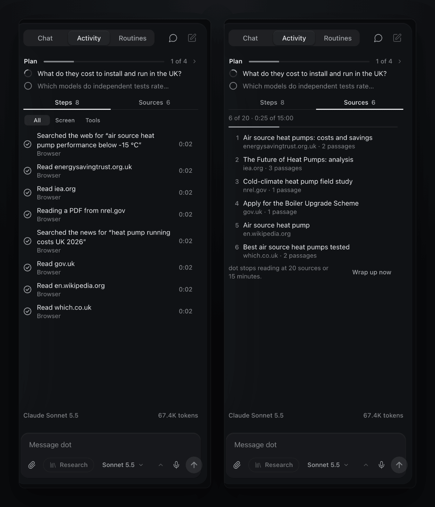

dot searches the web, images or news without touching the screen, and without a search key. If
one search engine doesn't answer, it asks the next. It reads a link the same way, as text or as
a picture, and it looks at the pictures it finds, which helps before it draws or designs
something. Neither uses a browser or any of your sign-ins. Both go out through keyd, like the
web browser's own traffic, and whatever comes back is handed to the model marked as untrusted.

For a bigger question, turn on **Research** in the message box (dot suggests it when a question
reads like one). dot splits the question into a few smaller ones, reads widely, and numbers every
page it reads as a source. It stops at 20 sources or 15 minutes unless you change that in
Settings, and you can tell it to wrap up early or keep going. You get a report with citations,
as Markdown and as a PDF, with the passages it quoted from each source.

### Pick the model, see what it used

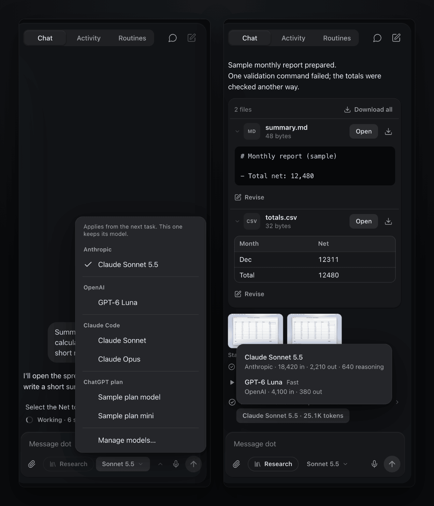

The chip in the message box names the model doing the work. Open it to pick from every model
you've set up, grouped by provider and plan; **Manage models…** at the bottom takes you to
Settings. Configuring another provider keeps the models you already added. A switch applies to
the next task; the running task keeps its model. If a task is held by a model or credit limit,
choose an available model and **Continue** retries with that selection.

Under each finished reply, a quiet line names the model and the tokens it used. For a reply that
was just talk it adds the time, and the cost when your provider billed it. Tap the line to see
each model's tokens.

### Talk to it

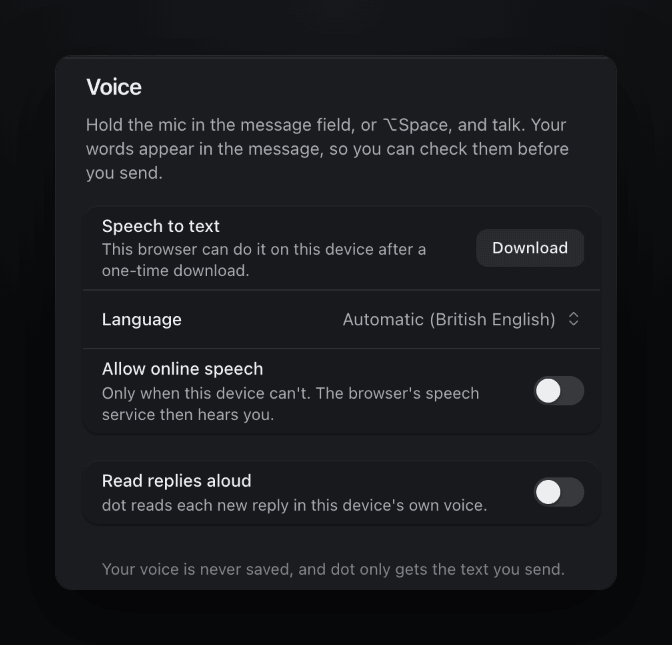

Hold the mic in the message box, or press ⌥Space (Ctrl+Shift+Space off a Mac), and talk. Your
words land in the message so you can check them before you send. The speech is turned into text
on your device when the browser can do it, or by a whisper.cpp model you already have on your
Mac. The browser's online speech service is only used if you allow it. dot can also read its
replies aloud in your device's own voice. Cancel recording or dismiss a microphone notice to
return immediately to the normal controls. Your voice is never saved.

### It asks, right where you are

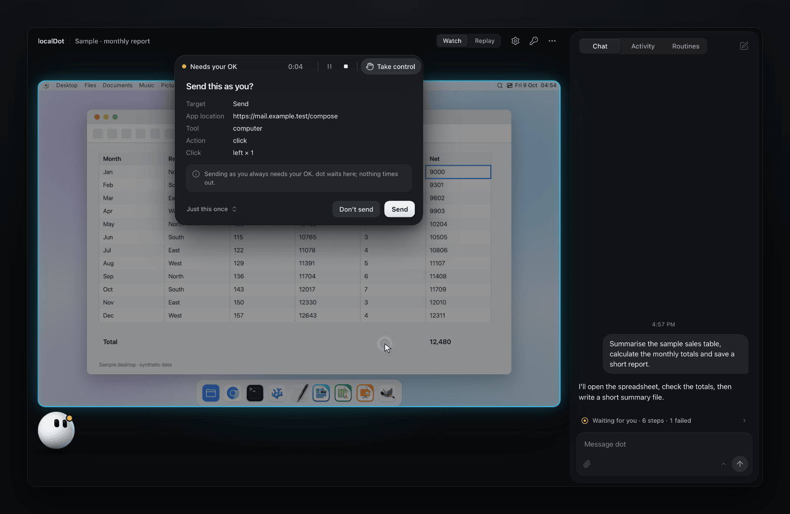

The shield in the message box opens **Permissions**:

- **Custom** follows your autonomy and tool settings, including the Balanced and Careful presets.
- **Auto** lets Jev review routine actions, asking you when it cannot approve them.
- **Full access** runs actions without routine confirmation, while destructive actions still ask.

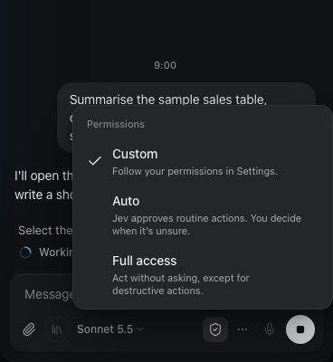

Under the default Custom/Balanced settings, sending as you, paying, uploads and account changes
ask first. The card says what will happen, and eligible answers can cover this once, the task,
the site or always. Network isolation and private credential handling apply in every mode.

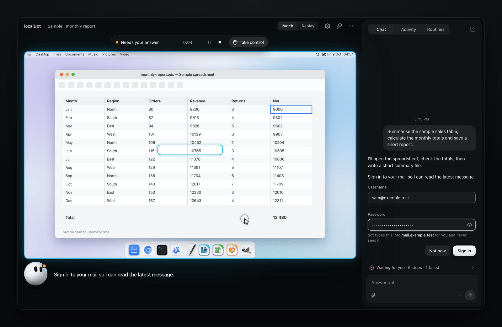

When dot needs a sign-in, the form shows up in the chat (or as a sheet on your phone). You type
the account and password once. localDot saves supported browser logins in its protected local
vault, fills the verified sign-in form and submits it. Later tasks can reuse the saved login
for the same HTTPS site without asking again. The password stays out of model input and
conversation logs. Saved accounts are also reused on username-first pages; missing or rejected
fields are requested separately. Authenticator, email, SMS, and recovery codes use private inputs
and are never saved as passwords. Device approval, passkeys, security challenges, and unsupported
forms may still need you; a handoff tells you why. Connected-app access and website sign-ins are
separate: dot uses the access already available for the kind of work requested. See [browser sign-ins](docs/browser-workspace.md#sign-in-once).

### Take over any time

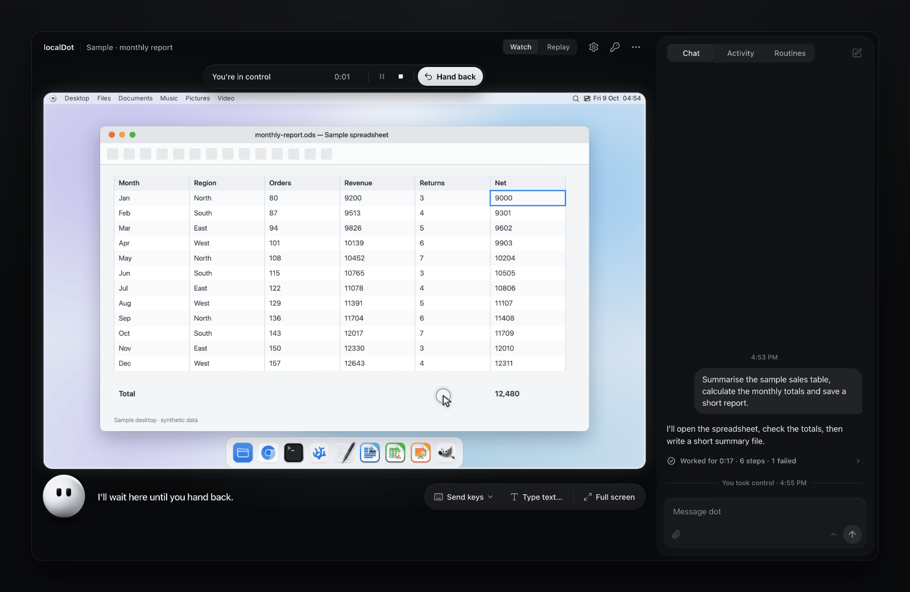

Press **Take control** and the computer is yours: mouse, keyboard, paste, the lot. dot can't see
or touch anything until you hand it back, and that stretch isn't recorded. Full screen is one
click away when you want the whole display. Conversation history stays available during takeover.

### Your apps, as tools

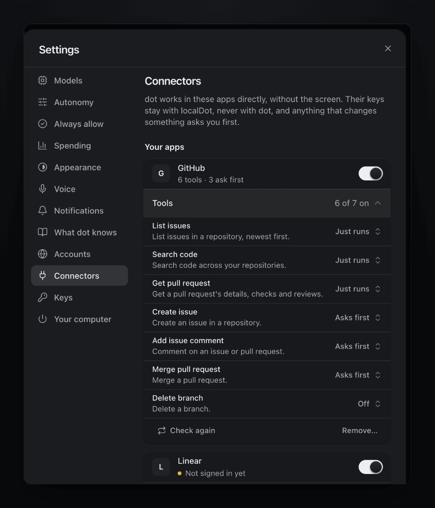

Some jobs are quicker without the screen. In **Settings → Connectors** you can give dot your
apps directly: GitHub, Linear, Notion, Sentry, Brave Search and DeepWiki are a click away, and any
other MCP server can be added by its address or the command that runs it. Each tool is set to
**Just runs**, **Asks first** or **Off**. With Custom permissions, reading runs and changes ask
first by default; the card shows exactly what dot would send. Keys and sign-ins stay in keyd and only
ever go to their own app. An app that runs as a program gets a sealed cell of its own: read-only,
none of your files, and no way out except through keyd.

### On your phone

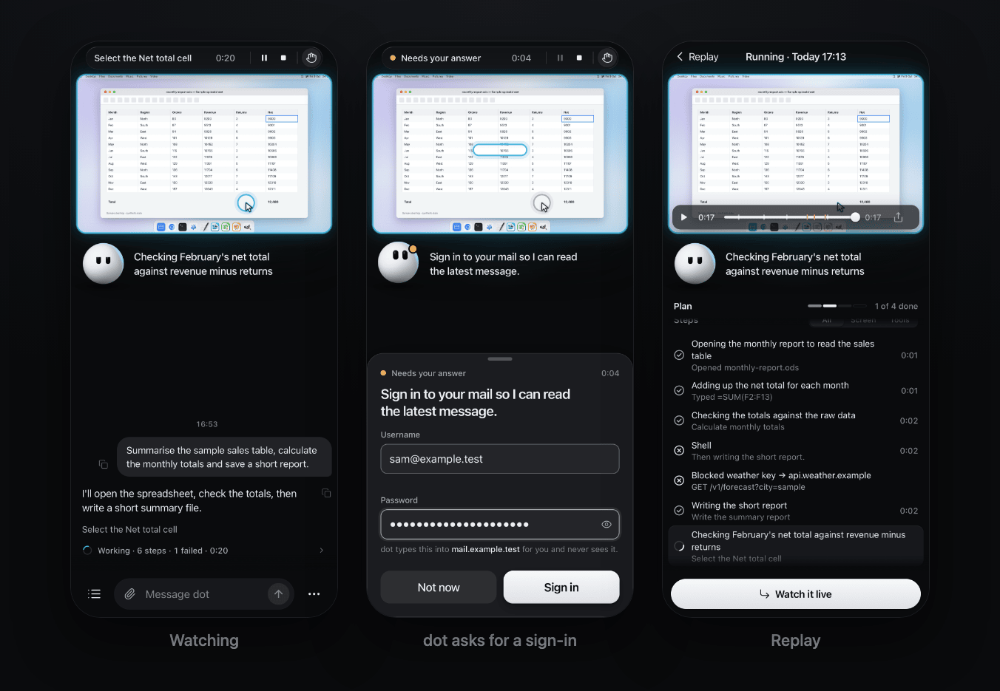

Same app, laid out for a thumb, with a compact composer and a separate model picker. Put localDot on
your tailnet and it works from anywhere, and it will nudge your phone when dot needs you.

### Replay and export

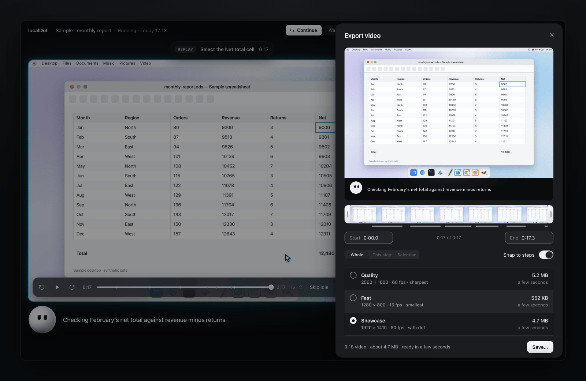

Every task is recorded locally. Scrub through it, compare before and after for any step, skip
the idle bits. Export trims to the part you want and comes with presets: **Quality**, **Fast**
(small and quick) and **Showcase**, which puts dot and its lines into the video. Exports run on
your Mac, so closing the tab doesn't cancel them.

### What it made

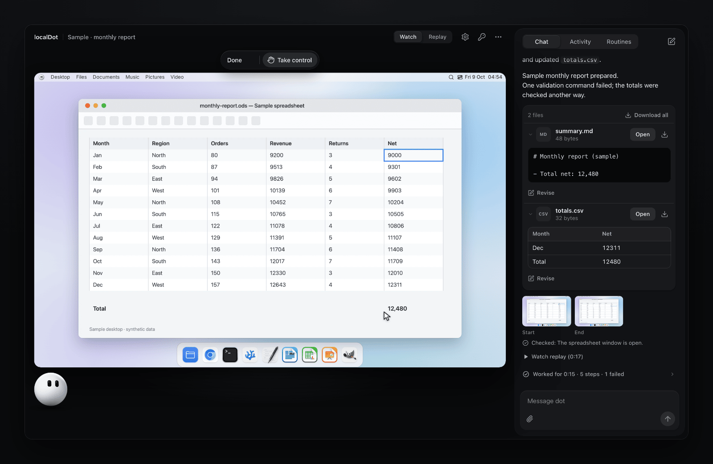

When dot finishes you get the files with previews (images, PDFs, HTML in a sandbox, text, code,
CSV and spreadsheets, audio and video), a before and after screenshot as proof of work, and
**Revise** for when it's nearly right. Revised files keep their versions, with Compare. Open a
PDF, a document or a deck in full and you can page through it, with thumbnails, and a deck can
present a slide at a time.

### Routines

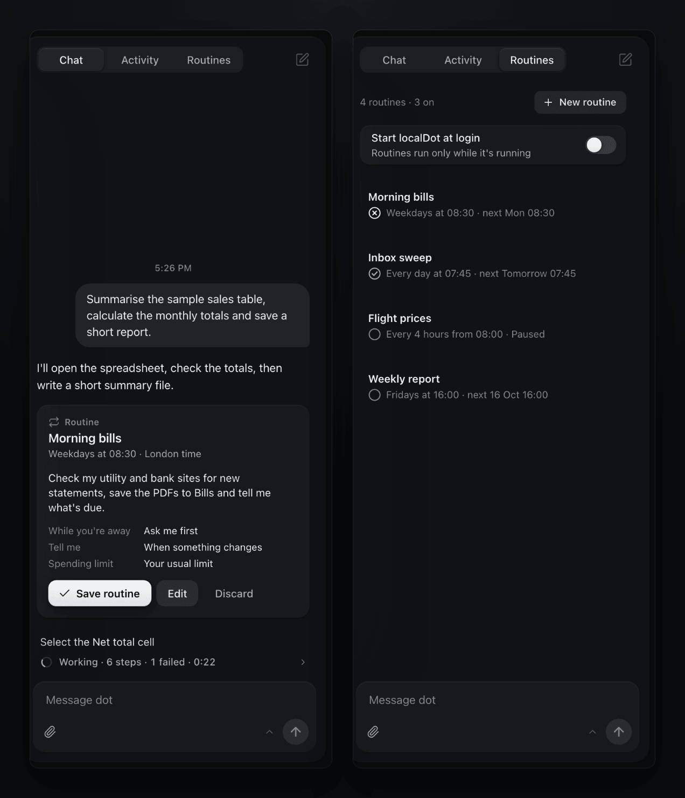

Checking the same three sites every weekday at 8:30? dot can offer to turn a task into a routine,
or you can write one yourself. Routines run while localDot is running, with the same checks, and
you choose what happens when you're away.

### First run and Settings

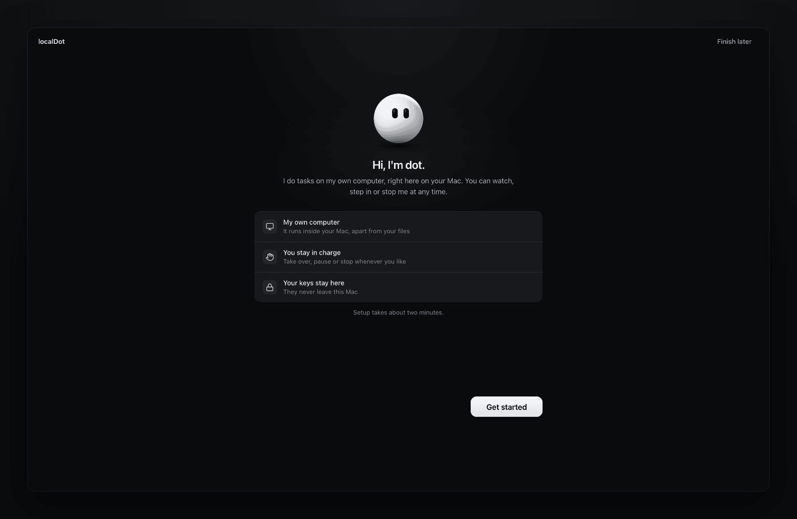

Setup walks you through a model, a key or a sign-in, how careful dot should be, and turning the
computer on. It takes about two minutes and you can skip it.

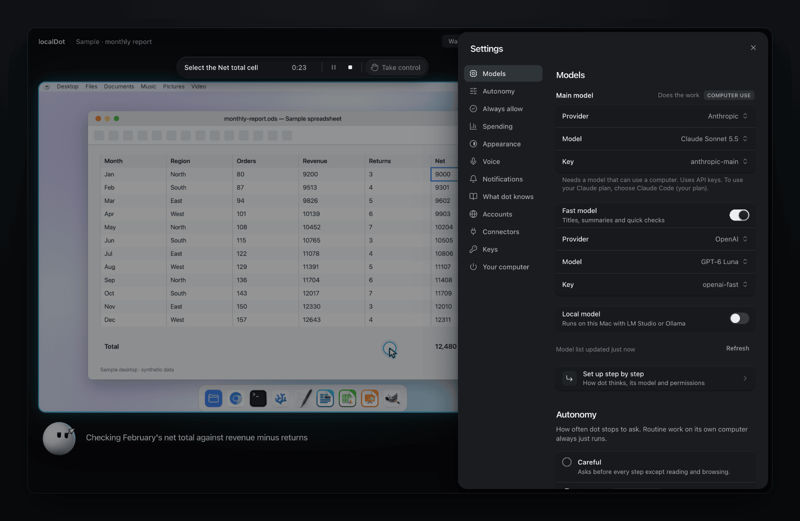

Settings has the rest: models, autonomy, the things you've always allowed, research limits,
spending limits (off until you want them), voice, what dot remembers about you (all of it
editable and deletable), the sites you're signed in to, your apps, and your keys.

### The computer itself

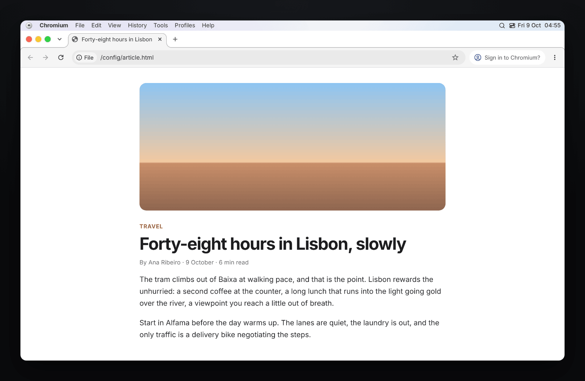

It's Linux in containers, dressed to feel familiar: menu bar, dock, a launcher, traffic lights.
It comes with Chromium, LibreOffice, GIMP, a code editor and a terminal. Sign-ins in its web
browser stay put across restarts and new tasks, so you log in once. If the web browser stops
answering, localDot attempts to restart it with the saved profile.
A failed browser action is never silently redirected into the desktop's Chromium.

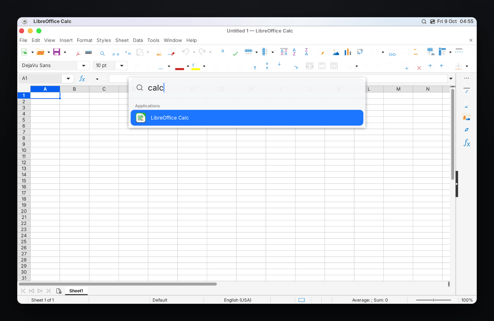

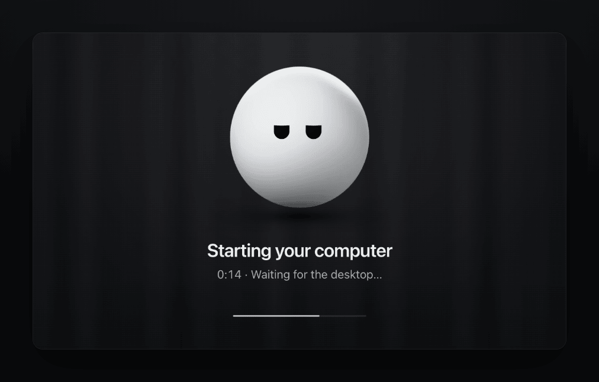

Starting, updating and restarting the computer show real progress from localDot itself, and a
start names each step on the way, from the network to the desktop to the screen. Refresh the page
or open a second tab and you see the same count, not a fresh one.

## Meet dot

<p align="center">
  
</p>

dot is the little white ball doing the work, and it picks up whatever the job needs. A keyboard
when it types, a terminal when it runs code, a magnifier when it looks closely, a paper plane
when something is going out. It glides from one to the next, waves when it needs you, and
squints happily when it's done. When nothing is going on, it says hello and offers the odd tip.
It has no other hobbies.

At rest, dot is pinned to its spot on the page, so scrolling or dragging a panel carries it
along with no lag. And dot keeps its troubles to itself: if its own code ever fails,
it steps out for a few seconds and comes back, and the rest of the app carries on.

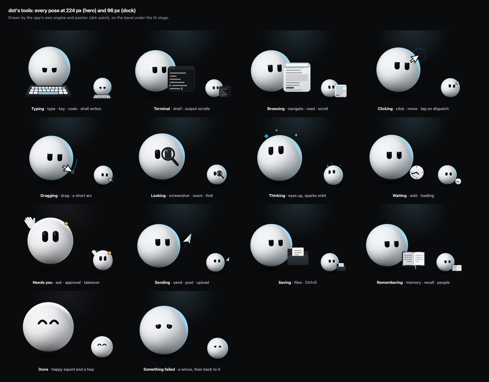

## How it works

<picture>
  <source srcset="docs/readme/system.svg" type="image/svg+xml">
  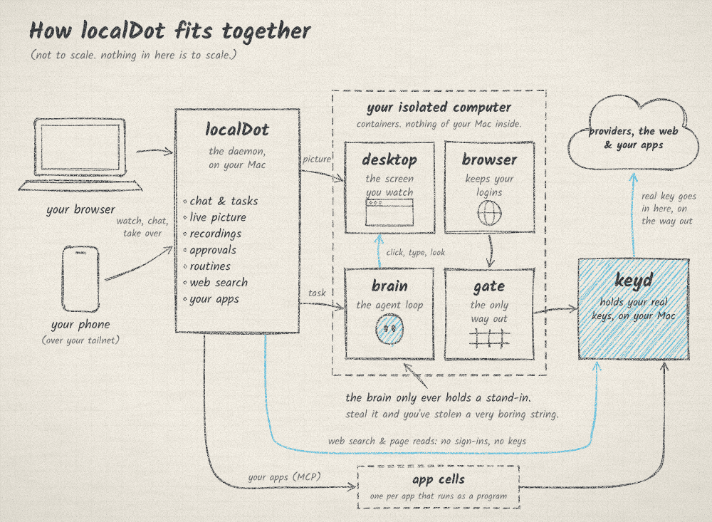
</picture>

| Part | What it does |
| --- | --- |
| **Daemon** | The app itself, on your Mac (TypeScript on Node). Serves the web UI, runs tasks, streams the picture, records everything, and decides what needs your OK. |
| **Desktop** | The screen you watch: a Linux desktop streamed as H.264. dot clicks, types and drags here. |
| **Web browser** | A separate browser that keeps your sign-ins. The desktop can't read its cookies. |
| **Brain** | The agent loop that talks to the model. It holds stand-in keys only. |
| **Gate** | The computer's only way out to the network. No LAN, no router, no cloud metadata. Apps that ignore the proxy are caught here and checked like everything else. |
| **Web tools** | Web search and page reading, done by the daemon itself through a keyd listener of their own. It reaches public websites only and carries no sign-ins and no keys. |
| **App cells** | One sealed container for each of your apps that runs as a program: read-only, none of your files, and a gate that only reaches keyd. Apps on the internet are reached through keyd directly. |
| **keyd** | A small Go service that keeps your real keys (in the macOS Keychain, your Linux keyring or an encrypted file), checks where everything is going, and swaps the keys in at the edge. |

<picture>
  <source srcset="docs/readme/task-loop.svg" type="image/svg+xml">
  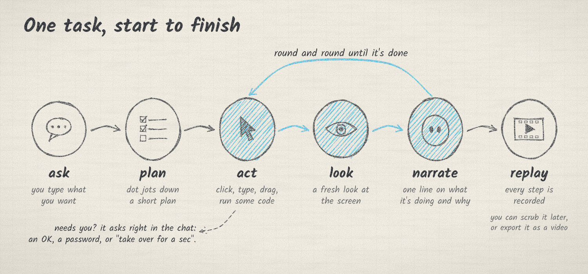
</picture>

A task goes round a simple loop: act, take a fresh look at the screen, say what happened, repeat.
dot can batch several actions into one turn and find buttons by name instead of hunting for
pixels, which is a big part of why it got quicker (see the numbers below). Not every step needs
the screen: searching, reading a page and using one of your apps happen directly, and they show
up in the same step list.

## Safety

<picture>
  <source srcset="docs/readme/safety.svg" type="image/svg+xml">
  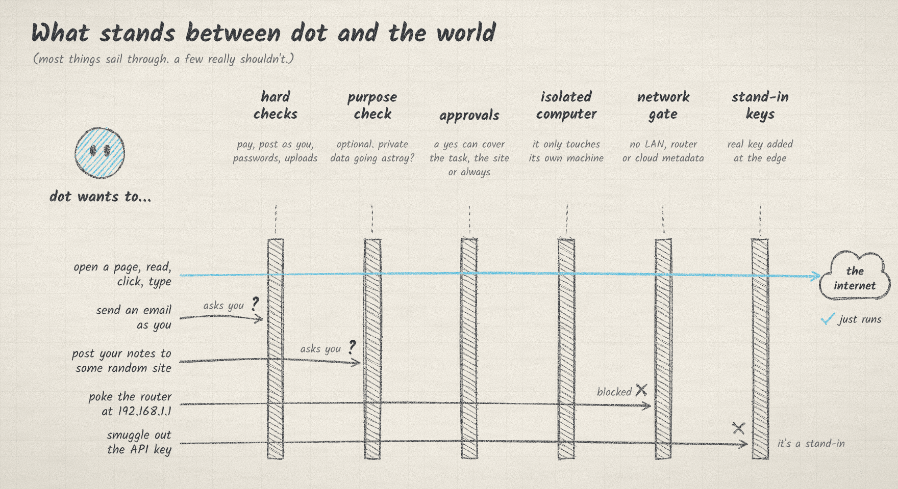
</picture>

What asks and what doesn't, with **Custom** permissions and the default **Balanced** preset:

| dot wants to… | What happens |
| --- | --- |
| Click, type, scroll or drag on its own computer | Just runs |
| Open pages, read, search the web | Just runs |
| Read something with one of your apps | Just runs |
| Run code or a terminal command on its own computer | Just runs |
| Send a message or email as you, or post as you | Asks first |
| Pay for or buy something | Asks first |
| Sign in to a supported HTTPS site | Uses a saved login or asks once in a private form; the model never sees the password |
| Upload your files somewhere | Asks first |
| Change account settings or delete data on a remote service | Asks first |
| Change something with one of your apps | Asks first, with exactly what it would send (you can set each tool) |
| Let an app on its computer connect beyond websites, such as another port | Asks first, naming the app, the host and the port |
| Send private data somewhere unrelated to the task | Asks first, when the purpose check is on |
| Reach your LAN, your router or cloud metadata | Blocked |
| Use an API key | Gets a stand-in; the real key is added at the edge, for that key's hosts only |

The **Careful** preset asks before every step except reading and browsing. **Auto** and
**Full access** change the confirmation policy as described above. Eligible answers
can be scoped: just this once, for this task, for this site, or always, and you can take an
"always" back in Settings.

The purpose check is optional and recommended. It looks at where data is going (the host, the
size and shape of what's being sent, whether it overlaps private text dot has seen), never at the
private content itself, and it only asks when something private is heading somewhere the task
has no business going. Web searches count too: a query is checked against every search engine it
might go to, and so are the pages dot reads and what it sends to your apps.

Search results, pages and whatever your apps return reach the model marked as untrusted, as
something to read rather than instructions to follow. What your apps return also counts as
private, so the purpose check keeps an eye on where it goes next.

## Numbers

All measured on one Mac Studio (M3 Ultra) with sample data. Your Mac, your network and your model
will give different numbers. They're here to show the direction, not to win an argument. The
details are in [docs/measurements/2026-10-readme-numbers.md](docs/measurements/2026-10-readme-numbers.md).

<picture>
  <source srcset="docs/readme/chart-screenshots.svg" type="image/svg+xml">
  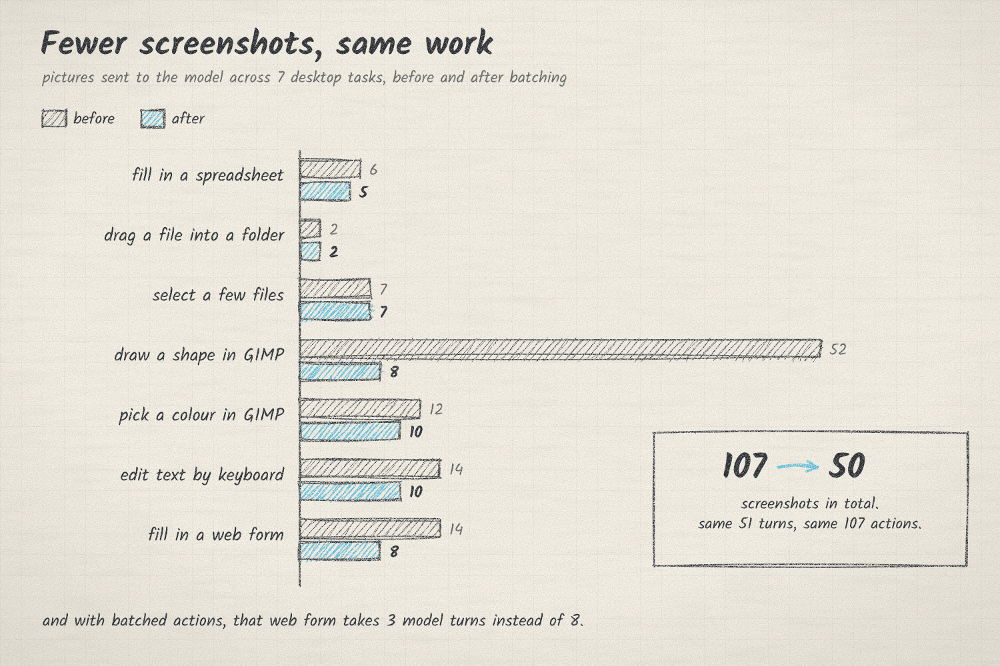
</picture>

<picture>
  <source srcset="docs/readme/chart-export.svg" type="image/svg+xml">
  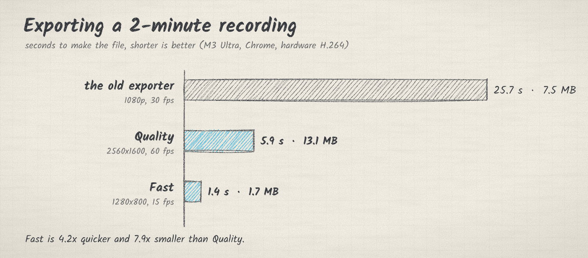
</picture>

<picture>
  <source srcset="docs/readme/chart-stream.svg" type="image/svg+xml">
  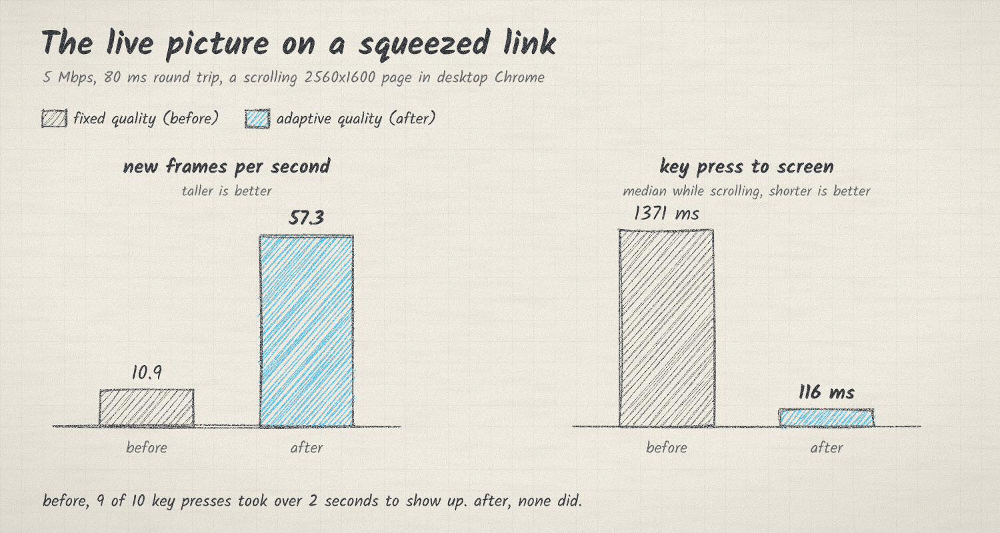
</picture>

| What | Before | After |
| --- | --- | --- |
| Screenshots sent to the model, 7 desktop tasks | 107 | 50 |
| Model turns to fill in a web form | 8 | 3 |
| Export a 2-minute recording, Quality (2560×1600, 60 fps) | 25.7 s (old exporter, 1080p 30 fps) | 5.9 s, 13.1 MB |
| Export a 2-minute recording, Fast (1280×800, 15 fps) | | 1.4 s, 1.7 MB |
| New frames per second on a 5 Mbps, 80 ms link | 10.9 | 57.3 |
| Key press to screen while scrolling, same link (median) | 1371 ms | 116 ms |
| First frame after a page reload | | 214 ms (Chrome), 209 ms (WebKit) |

## Models

dot needs a main model that can use a computer, meaning it can look at a screenshot and point at
things. A fast model for titles and quick checks is optional, and so is a local one. Set them up
in Settings → Models, then switch between them from the chip in the message box.

| Kind | Options | Good to know |
| --- | --- | --- |
| API keys | Anthropic, OpenAI, Google Gemini, Azure OpenAI, xAI, Mistral, DeepSeek, Groq, OpenRouter, Together, Fireworks, Cerebras, Perplexity, Cohere, DeepInfra, Moonshot (Kimi), Alibaba (Qwen), Z.ai, Zhipu AI, MiniMax, Volcengine Ark, SiliconFlow | Keys live in keyd on your Mac. Prices come from the models.dev catalogue. |
| ChatGPT plan | Sign in with a code, runs through Codex | Apple silicon Macs; enabled only in builds with native and real-account acceptance recorded. localDot keeps its own Codex home, separate from yours. |
| Claude Code (your plan) | Your own installed Claude Code | Uses your plan's limits. localDot never touches your Claude sign-in, settings or memory files. Off until you choose it. |
| Coding and token plans | MiniMax Token Plan, Alibaba Token Plan, Alibaba Coding Plan | Some vendors only allow their coding plans inside the coding tools they list (GLM Coding Plan, Kimi For Coding, Ark Coding Plan). For those, use the vendor's API key instead. |
| Your own endpoint | Any OpenAI-compatible or Anthropic-compatible base URL | You give it the model ID, what the model can do and what it costs. |
| On your Mac | LM Studio, Ollama | No key, no bill, and the model calls never leave your Mac. |

## Install

localDot runs on macOS, Linux and Windows (through WSL 2). dot's computer is Linux containers
everywhere, so every platform runs the same one. You'll need Docker (Engine 28 or newer), git,
curl and about 15 GB of disk. The installer brings its own Node.js and Go, installs nothing
system-wide and never asks for sudo.

**macOS** (Apple silicon or Intel, with Docker Desktop) and **Linux** (x86-64 or ARM64 with
systemd, such as Ubuntu, Debian or Fedora), as your own user:

```sh
curl -fsSL https://raw.githubusercontent.com/Shadowhusky/localdot/main/install.sh | bash
```

**Windows 10 (2004 or newer) or 11**, in PowerShell:

```powershell
irm https://raw.githubusercontent.com/Shadowhusky/localdot/main/install.ps1 | iex
```

It turns on WSL 2 (Windows wants a restart for that, then run it again), installs Ubuntu if it
isn't there, turns on systemd and runs the same installer inside it. Your Windows browser reaches
localDot at `http://127.0.0.1:4750`, as if WSL weren't there at all.

The first run builds dot's computer, which takes 10 to 30 minutes; put the kettle on. Then it
starts localDot as your own user's services and prints a one-time sign-in link. Open it, follow
the setup and turn the computer on. If something is missing, the installer lists all of it up
front, with the commands to fix it, rather than one complaint at a time.

- **Upgrade:** `localdot update`, or run the installer again. Settings and data stay put.
- **Uninstall:** `localdot uninstall`. It keeps your data in `~/.localdot` and prints the commands
  that delete it, for when you really mean it.
- **Something looks off:** `localdot doctor` checks Docker, the images, the key service and the
  app.

**On a server with no screen:** give it a regular user with Docker access and lingering turned
on (the [install guide](docs/install.md#preparing-a-fresh-server) has the four commands), sign
in as that user over SSH and run the same `curl` line. localDot runs as systemd user services,
so it keeps going after you log out. Your keys go in an encrypted file there; if a passphrase
protects it, run `localdot unlock` after the server restarts.

### Reaching it from another device

localDot only listens on `127.0.0.1`, so nothing on your network can reach it directly. Keep it
that way: don't forward its port or put it on the public internet. There are two safe ways in.

- **SSH tunnel**, from your own computer: `ssh -N -L 4750:127.0.0.1:4750 you@your-server`. Run
  `localdot open` on the server and open the link on your computer within a minute. Keep the
  same port on both ends; localDot only answers to its own address.
- **Tailscale**, for your phone and everything else you own: install with
  `curl -fsSL https://raw.githubusercontent.com/Shadowhusky/localdot/main/install.sh | bash -s -- --tailscale`,
  or run `localdot update --tailscale`, once MagicDNS and HTTPS certificates are on in your
  tailnet. localDot gets an HTTPS address that only your own devices can reach, and
  `localdot open --qr` draws the sign-in link as a QR code for your phone. It never uses Tailscale Funnel, and neither should you for this port: that would
  publish localDot to the whole internet.

Everything else, from installer options and where things live to how your saved keys are kept,
is in [Installing localDot](docs/install.md). To build and run from source instead, see
[docs/development.md](docs/development.md).

## FAQ

**Does it touch my real computer?**
No. dot works on its own computer, in containers. It sees your files only when you attach them,
and its results open on your Mac only when you click Open.

**Could it email my boss without asking?**
With the default Custom/Balanced settings, sending as you asks first and the card shows what
would be sent. Auto can approve routine actions through Jev; Full access allows sending without
a routine confirmation. Choose the permission mode that matches the authority you want to give dot.

**What does it cost?**
localDot is free and MIT licensed. Models cost whatever your provider charges, and localDot shows
what each task spent. Spending limits are there when you want them, and off until you do.

**Where does my data go?**
Screenshots and the task's text go to the model provider you chose, and dot visits the sites the
task needs. Web searches go to public search engines, without your sign-ins. Pick a local model
and the model calls stay on your Mac.

**Why is it called dot?**
Look at it.

**Can I build on it?**
Yes. Skills are plain `SKILL.md` folders, dot's memory uses editable Markdown files and daily notes, and any MCP server can become one of dot's tools in Settings → Connectors. See
[docs/development.md](docs/development.md).

Reusable setup experience is saved with its project or workflow scope, conditions, source task,
and a check to perform before reuse. Relevant experience is loaded into new conversations and
routine runs. You can inspect, edit, or delete it under **What dot knows → Daily notes**.
It remains observed context, never permission to act. [Design and experiments](docs/experience-memory.md).

Text files with unfamiliar extensions open as text when their bytes are readable. Binary or
unavailable files show an explanation; failed text loads have **Try again**, and files remain downloadable.

## Contributing

Bug reports, ideas and pull requests are welcome. Building, testing and running from source are
covered in [docs/development.md](docs/development.md). Before sending a change, run
`pnpm typecheck`, `pnpm lint`, the tests for what you touched, and `pnpm hygiene` (it scans for
anything that looks like a key).

## Licence

[MIT](LICENSE). Third-party notices are in [THIRD-PARTY.md](THIRD-PARTY.md). The handwriting in
the diagrams is Kalam, under the SIL Open Font License
([docs/diagrams/fonts/OFL.txt](docs/diagrams/fonts/OFL.txt)).
