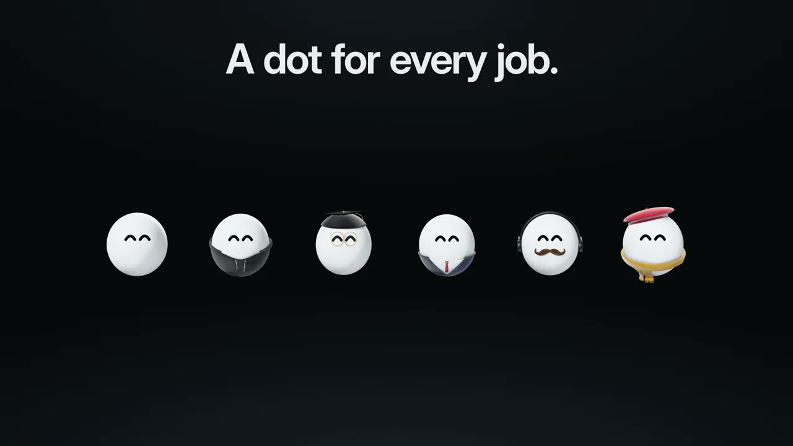
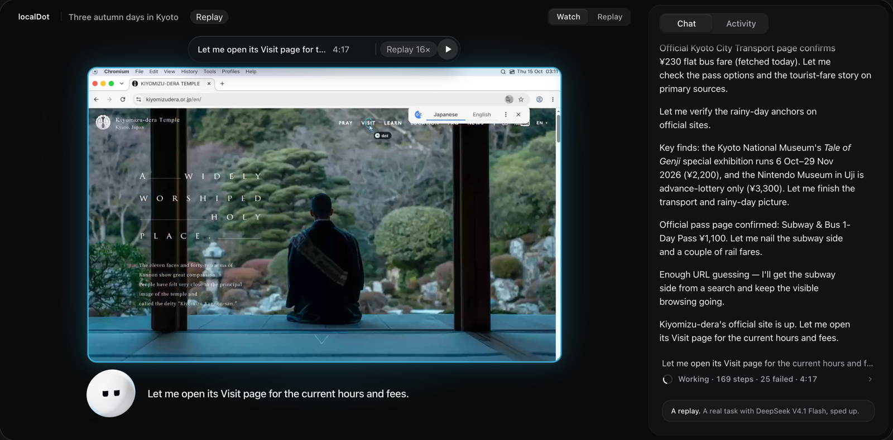

<p align="center">
  
</p>

<h1 align="center">localDot</h1>

<p align="center">An AI with a computer of its own.</p>

<p align="center">
  <b>English</b> · <a href="README.zh-CN.md">简体中文</a> · <a href="https://localdot.dev">localdot.dev</a>
</p>

<a href="https://localdot.dev/film/localdot-film.mp4"></a>

<p align="center"><a href="https://localdot.dev/film/localdot-film.mp4">▶ Watch the 37-second film</a></p>

dot does real work on a computer of its own, right on yours: a Linux desktop with a browser, a
terminal and everyday apps, running in Docker. You watch from your browser or your phone, step in
whenever you like, and every task is recorded.

## Install

**macOS (Apple silicon) or Linux (x64)**, in Terminal:

```sh
curl -fsSL https://downloads.localdot.dev/install.sh | bash
```

**Windows**, in PowerShell (alpha, runs through WSL 2):

```powershell
irm https://downloads.localdot.dev/install.ps1 | iex
```

The installer checks Docker and walks you through anything missing, then prints a link. Open it,
pick a model, and give dot something to do.

`localdot open` prints a fresh sign-in link, `localdot update` installs the latest release and
keeps your data, and `localdot doctor` diagnoses a problem.
[Install guide](docs/install.md) · [Use it from your phone or a server](docs/install.md#servers-without-a-screen)

## What dot does



- **Watch it work.** Live, from your laptop or your phone. You see every click and keystroke as it
  happens.
- **Step in any time.** Take control and the mouse is yours. Hand it back and dot picks up where
  you left off.
- **You decide how often it asks.** Custom, Auto or Full access. Even with full access, dot asks
  before buying anything or deleting things online.
- **Use any model.** An API key from 25 providers, your ChatGPT or Claude plan, or a model on
  your own machine. Switch any time.
- **Rewind anything.** Every task is recorded step by step. Scrub back to see exactly what dot
  did.
- **Share the good part.** Trim to the moment, speed it up as much as 16 times, add captions and
  save it as a video.
- **A dot for every job.** Everyday, coder, researcher, finance, video editor or designer. Each
  brings only the skills its work needs, so it stays focused and spends nothing on the rest.
- **Open source, and yours.** The app, dot's computer and every recording stay on your machine,
  and your keys live in a local vault.

<picture>
  <source media="(max-width: 600px)" srcset="docs/readme/capabilities-mobile.svg" type="image/svg+xml">
  <source media="(max-width: 600px)" srcset="docs/readme/capabilities-mobile.png">
  <source srcset="docs/readme/capabilities.svg" type="image/svg+xml">
  
</picture>

## Models

dot needs a model that can read screenshots and use tools. Add one in **Settings → Models**, then
pick it from the message box.

- **API keys:** Anthropic, OpenAI, Google Gemini, Azure OpenAI, xAI, Mistral, DeepSeek, Groq,
  OpenRouter, Together, Fireworks, Cerebras, Perplexity, Cohere, DeepInfra, Moonshot, Alibaba,
  Z.ai, Zhipu AI, MiniMax, Volcengine Ark and SiliconFlow.
- **Plans:** your Claude plan through Claude Code, your ChatGPT plan through Codex, and the
  MiniMax and Alibaba token and coding plans.
- **Your own:** any OpenAI- or Anthropic-compatible server, including Ollama and LM Studio on your
  machine.

Hosted models see screenshots and the task's context. [Model options](docs/model-options.md)

## Safety

<picture>
  <source media="(max-width: 600px)" srcset="docs/readme/safety-mobile.svg" type="image/svg+xml">
  <source media="(max-width: 600px)" srcset="docs/readme/safety-mobile.png">
  <source srcset="docs/readme/safety.svg" type="image/svg+xml">
  
</picture>

dot works on its own computer, not yours. Reading, searching, clicking and running code there just
happen. How often it asks first is up to you:

- **Custom**, the default, asks before dot sends or posts anything as you, pays for something,
  uploads your files, changes your account's security, or changes or deletes things online.
- **Auto** lets a reviewer model approve routine steps. Purchases, sign-ins and online deletions
  still ask you.
- **Full access** gets on with it, and still asks before every purchase and before deleting
  things online (once per site).

Your LAN, your router and cloud metadata are always blocked. Your real keys stay in keyd, a small
local service: dot only ever holds stand-ins, and the real key is added on the way out, for that
key's own hosts. Passwords go through a private form straight into the site, so dot never sees
them.

Pages, search results and app responses reach the model marked as untrusted. An optional purpose
check flags private data heading somewhere unrelated to the task. This is alpha software, so
review what dot does with your accounts. [How the agent runs](docs/agent-runtime.md) ·
[Purpose check](docs/purpose-check.md)

## How it works

Your browser talks to the localDot daemon on your machine, which serves the app, runs tasks,
streams dot's desktop and records every step. dot's computer is a set of containers: the desktop
you watch, a web browser that keeps your sign-ins, the agent's loop, and a gate that is its only
way out to the network.

<picture>
  <source media="(max-width: 600px)" srcset="docs/readme/system-mobile.svg" type="image/svg+xml">
  <source media="(max-width: 600px)" srcset="docs/readme/system-mobile.png">
  <source srcset="docs/readme/system.svg" type="image/svg+xml">
  
</picture>

A task goes round a simple loop: act, take a fresh look at the screen, say what happened, and
repeat until it's done. When dot needs you, it asks in the chat.

<picture>
  <source media="(max-width: 600px)" srcset="docs/readme/task-loop-mobile.svg" type="image/svg+xml">
  <source media="(max-width: 600px)" srcset="docs/readme/task-loop-mobile.png">
  <source srcset="docs/readme/task-loop.svg" type="image/svg+xml">
  
</picture>

| Folder | What's in it |
| --- | --- |
| `apps/daemon` | The daemon: API, agent loop, safety checks, tools and recordings (TypeScript on Node) |
| `apps/web` | The app you open in your browser (React) |
| `apps/site` | localdot.dev and the film |
| `packages/protocol` | Types shared by the daemon and the app |

Run it from source: [development guide](docs/development.md).

## Help

- [Open an issue](https://github.com/Shadowhusky/localdot/issues) with what you did and what
  `localdot doctor` says.
- `localdot report`, or Settings › Report a problem, sends the team a redacted diagnostics report
  and gives you its ID to quote ([what it holds](docs/diagnostics.md)).
- Other devices: Tailscale, an SSH tunnel, or the optional relay in Settings
  ([remote access](docs/remote-access.md)).
- `localdot uninstall` removes localDot and keeps your data in `~/.localdot`.

## Licence

[MIT](LICENSE). Third-party notices are in [THIRD-PARTY.md](THIRD-PARTY.md).
