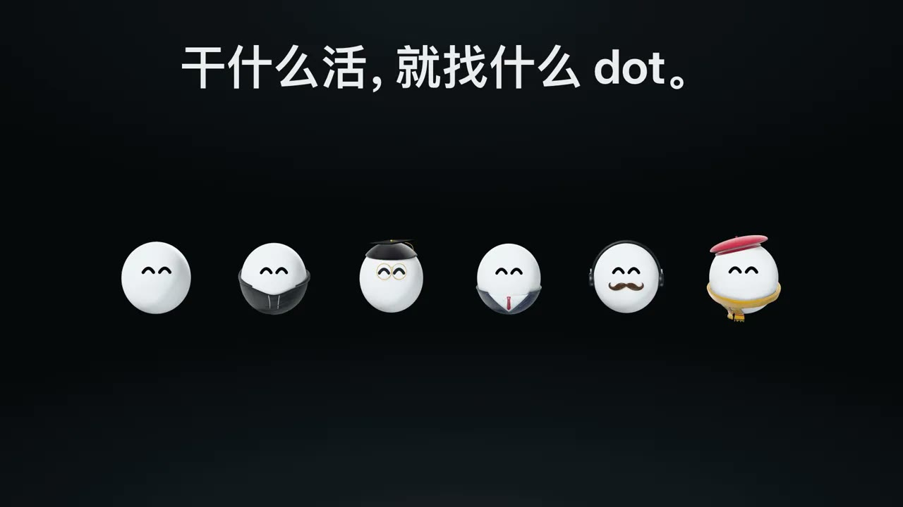
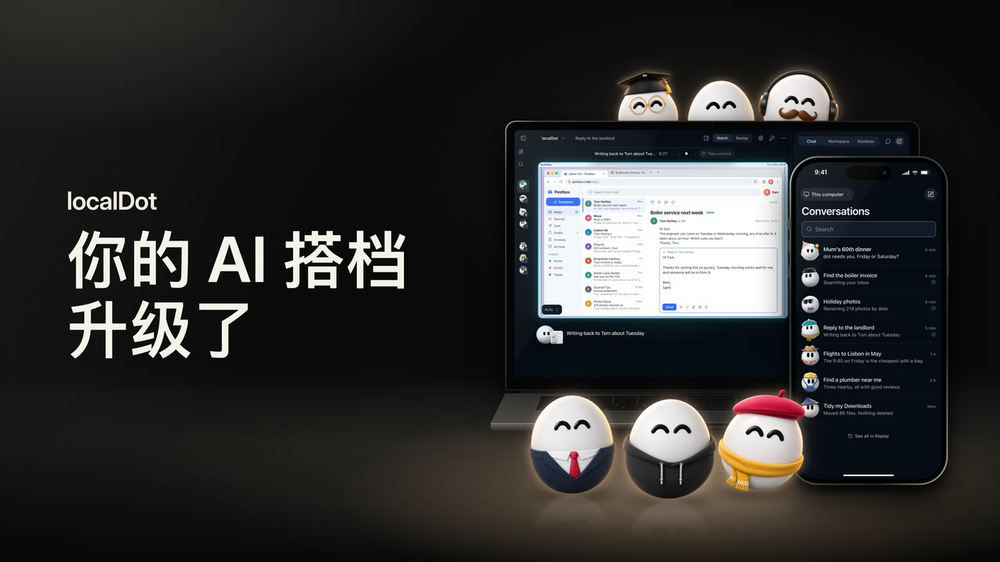
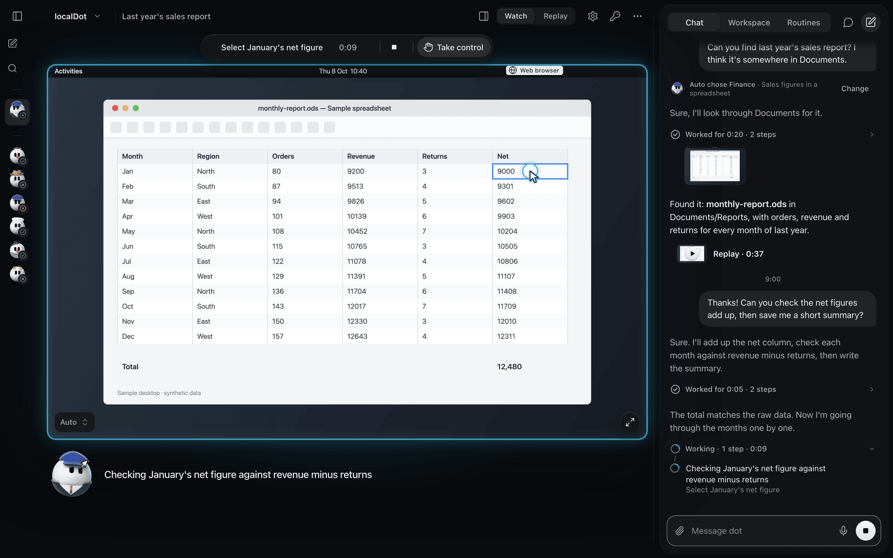
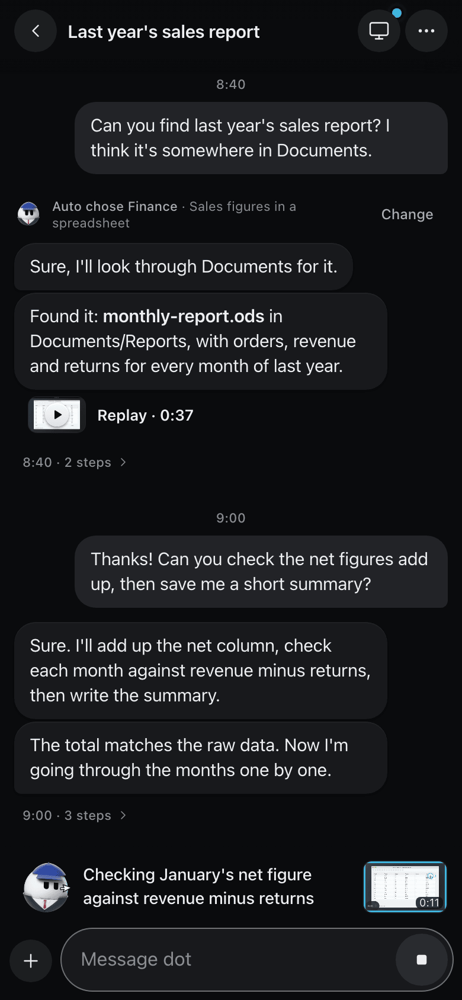
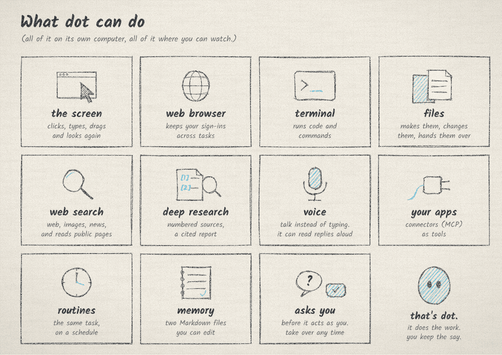
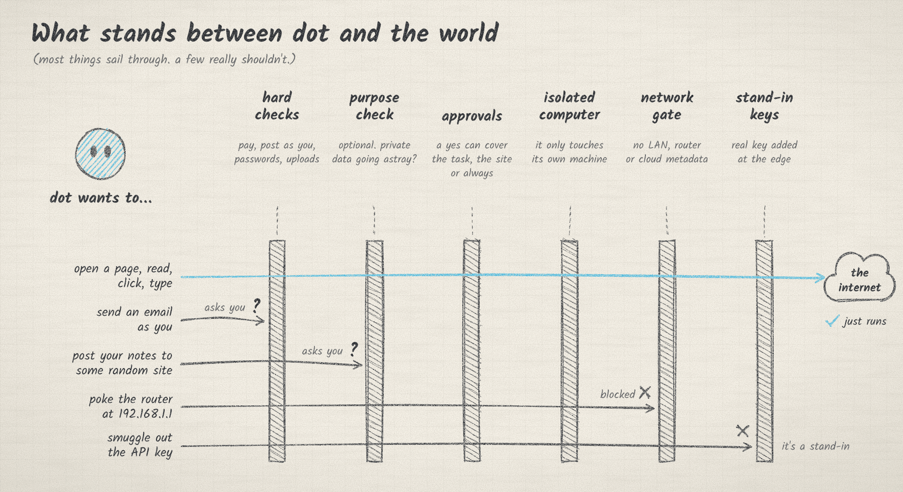
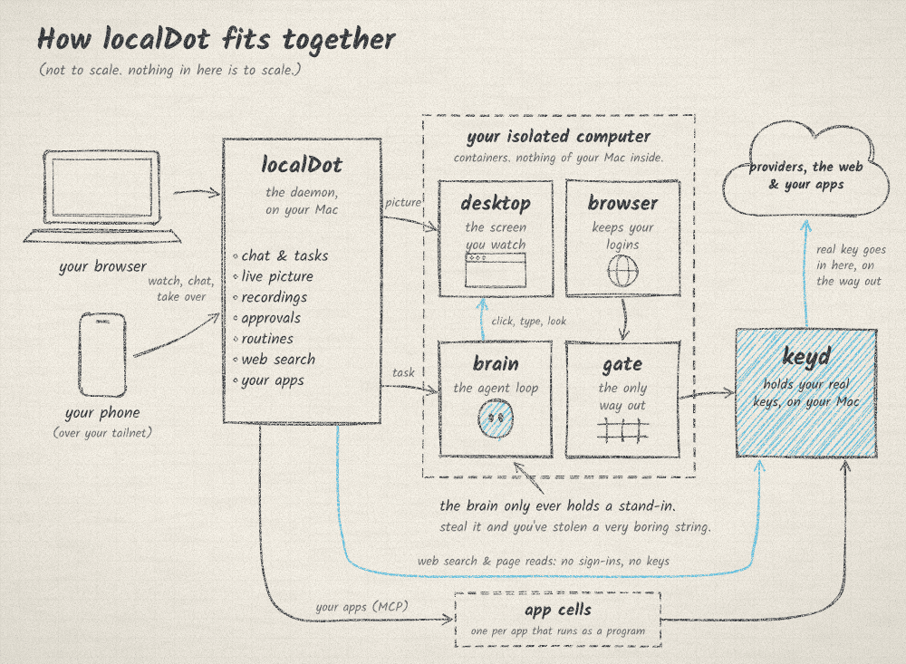
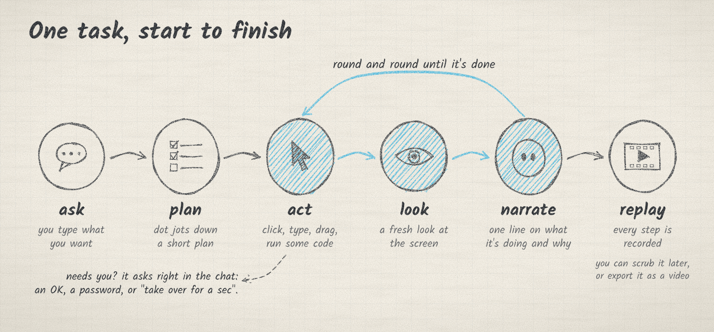

<p align="center">
  
</p>

<h1 align="center">localDot</h1>

<p align="center">给 AI 一台自己的电脑。</p>

<p align="center">
  <a href="README.md">English</a> · <b>简体中文</b> · <a href="https://localdot.dev/?lang=zh">localdot.dev</a>
</p>

<a href="https://localdot.dev/film/localdot-film-zh.mp4"></a>

<p align="center"><a href="https://localdot.dev/film/localdot-film-zh.mp4">▶ 看看这段 37 秒的短片</a></p>

<a href="https://localdot.dev/film/localdot-update-zh.mp4"></a>

<p align="center"><a href="https://localdot.dev/film/localdot-update-zh.mp4">▶ 看看这次更新了什么</a></p>

dot 在你的电脑里有一台自己的小电脑：一个跑在 Docker 里的 Linux 桌面，浏览器、终端和常用软件都有。你交代的事，它来帮你做。你可以在电脑或手机的浏览器里看着它干活，随时接管，每个任务都会完整录下来。

## 安装

**macOS（Apple 芯片）或 Linux（x64）**，在终端里运行：

```sh
curl -fsSL https://downloads.localdot.dev/install.sh | bash
```

**Windows**，在 PowerShell 里运行（目前还是早期测试版，通过 WSL 2 运行）：

```powershell
irm https://downloads.localdot.dev/install.ps1 | iex
```

安装程序会先检查 Docker，缺什么会带着你一步步装好，最后给出一个链接。打开链接，选好模型，就可以把任务交给 dot 了。

常用命令：`localdot open` 重新生成登录链接，`localdot update` 升级到最新版（数据会保留），`localdot doctor` 帮你排查问题。dot 用的浏览器是 Chromium，想换成 [Google Chrome](docs/install.md#google-chrome)，安装时选一下就行。[安装说明](docs/install.md) · [用手机或服务器访问](docs/install.md#servers-without-a-screen)（文档为英文）

## dot 能帮你做什么

 

下面让 dot 自己说：

- **看着我干活。** 手机、电脑，随时打开就能看，画面清晰。我点了哪里、输入了什么，你都看得清清楚楚。
- **想发消息还是想盯屏幕，你挑。** Chat 就像跟我发微信，要看我的电脑，点一下就行，手机上默认就是它。Studio 把我的电脑、对话和每一步摆在一个屏幕上。安装时选一个，之后随时换，每台设备各选各的。
- **随时插话，随时接管。** 我干活的时候你尽管发消息，我下一步就能看到。话太长我会当成附件收着，光发文件不说话也行，排队的消息还能调顺序。想自己来就点「接管」，交还后我从你停下的地方接着做。
- **问不问你，你说了算。** 有 Custom（自定义）、Auto（自动）、Full access（完全放手）三种模式。就算完全放手，买东西、删网上的内容之前，我也会先问你。
- **几件事，一起交给我。** 每个任务都有自己的 dot，打扮各不相同，一眼就认得出来。大家共用一个浏览器，各开各的窗口，登录状态也是共用的，所以两个任务可以同时在同一个网站上干活。
- **什么模型都能用。** 支持 25 家服务商的 API Key，也能直接用你的 ChatGPT 或 Claude 会员，还可以用你电脑上的本地模型。每个任务、每条消息都能单独选，每一步用的是哪个模型也看得到。
- **定时的活，到点我自己开工。** 例行任务可以设开始和结束日期，时间随你排：工作日早上 8:30、上班时间每 15 分钟一次、每月最后一天，一个任务还能排好几种。每次跑的记录都留在同一段对话里。
- **随时倒回去看。** 每一步都有迹可循。往回拖动，就能看到我当时是怎么做的。
- **精彩片段，随手分享。** 想要哪段就剪哪段，最高 16 倍加速，还能配字幕，最后导出成视频。
- **干什么活，就找什么 dot。** 日常助手、程序员、研究员、财务、剪辑师、设计师，每个 dot 只带本职工作需要的技能，更专注，也更省 token。
- **开源，由你掌控全局。** 代码采用 MIT 协议开源。应用、我的电脑和所有录像都保存在你自己的电脑上，API Key 也只存在本地。

<picture>
  <source media="(max-width: 600px)" srcset="docs/readme/capabilities-mobile.svg" type="image/svg+xml">
  <source media="(max-width: 600px)" srcset="docs/readme/capabilities-mobile.png">
  <source srcset="docs/readme/capabilities.svg" type="image/svg+xml">
  
</picture>

## 模型

dot 需要一个能看懂截图、会调用工具的模型。在 **Settings → Models** 里添加，一个 Key 下面的模型想开几个开几个，然后在输入框里选用。

- **API Key：** Anthropic、OpenAI、Google Gemini、Azure OpenAI、xAI、Mistral、DeepSeek、Groq、OpenRouter、Together、Fireworks、Cerebras、Perplexity、Cohere、DeepInfra、月之暗面（Moonshot）、阿里云百炼、Z.ai、智谱 AI、MiniMax、火山方舟、硅基流动。
- **会员套餐：** 通过 Claude Code 使用 Claude 会员，通过 Codex 使用 ChatGPT 会员，也支持 MiniMax 和阿里云的 Token Plan、Coding Plan。
- **自己部署的模型：** 任何兼容 OpenAI 或 Anthropic 接口的服务都行，包括在本机运行的 Ollama 和 LM Studio。

用云端模型时，截图和任务内容会发给模型服务商。[模型说明](docs/model-options.md)

## 安全

<picture>
  <source media="(max-width: 600px)" srcset="docs/readme/safety-mobile.svg" type="image/svg+xml">
  <source media="(max-width: 600px)" srcset="docs/readme/safety-mobile.png">
  <source srcset="docs/readme/safety.svg" type="image/svg+xml">
  
</picture>

dot 在它自己的电脑上干活，跟你的电脑是隔开的。在那台电脑上看网页、搜索、点击、跑代码，它都直接做。什么时候先问你，由你决定：

- **Custom（自定义）** 是默认模式：以你的名义发消息或发帖、付钱买东西、上传你的文件、改账号的安全设置，或者修改、删除网上的内容之前，都会先问你。
- **Auto（自动）** 让一个审核模型帮你批准日常操作，但购物、登录和删除网上内容仍然会问你。
- **Full access（完全放手）** 直接把事做完，只在每次购物前、以及删除网上内容前（每个网站一次）问你。

你的局域网、路由器和云服务的元数据接口，它一律访问不了。真正的 API Key 存在本地一个叫 keyd 的小服务里，dot 手里只有替身，请求发出去的那一刻才换成真 Key，而且只对这个 Key 自己的服务地址有效。密码通过一个私密表单直接填进网站，dot 看不到。

任务之间没有隔离：它们共用这台电脑上的文件和浏览器的登录状态，在一个任务里退出登录，其他任务也就退出了。不过每个任务只能看到、操作自己的浏览器窗口。Google Chrome 只有你同意 Google 的条款才会装：localDot 从 Google 官方下载，安装包里从不带它。

网页、搜索结果和第三方应用返回的内容，都会标成「不可信」再交给模型。另外还有一个可选的「用途检查」：私人数据要发到跟任务无关的地方时，会先问你一声。localDot 目前还是早期测试版，涉及你的账号时，记得留意 dot 做了什么。 [agent 运行机制](docs/agent-runtime.md) · [用途检查](docs/purpose-check.md)

## 工作原理

你的浏览器连接本机上的 localDot 守护进程（daemon）。它负责提供界面、执行任务、把 dot 的桌面实时推给你，并记下每一步。dot 的电脑由几个容器组成：你看到的桌面、一个会记住你登录状态的浏览器、agent 的主循环，还有一道网关，那是它连外网的唯一出口。浏览器显示在主屏幕上，但住在单独受保护的容器里，桌面上跑的程序读不到你的登录状态。

<picture>
  <source media="(max-width: 600px)" srcset="docs/readme/system-mobile.svg" type="image/svg+xml">
  <source media="(max-width: 600px)" srcset="docs/readme/system-mobile.png">
  <source srcset="docs/readme/system.svg" type="image/svg+xml">
  
</picture>

每个任务都按同一个循环推进：动手，重新看一眼屏幕，说明进展，一直到做完。需要你的时候，它会在对话里问你。

<picture>
  <source media="(max-width: 600px)" srcset="docs/readme/task-loop-mobile.svg" type="image/svg+xml">
  <source media="(max-width: 600px)" srcset="docs/readme/task-loop-mobile.png">
  <source srcset="docs/readme/task-loop.svg" type="image/svg+xml">
  
</picture>

| 目录 | 内容 |
| --- | --- |
| `apps/daemon` | 守护进程：API、agent 循环、安全检查、工具和录像（Node 上的 TypeScript） |
| `apps/web` | 你在浏览器里打开的应用（React） |
| `apps/site` | 官网 localdot.dev 和宣传短片 |
| `packages/protocol` | 守护进程和应用共用的类型定义 |

想从源码运行？看[开发指南](docs/development.md)。

## 遇到问题

- 到 [Issues](https://github.com/Shadowhusky/localdot/issues) 提问，写清楚你做了什么，再附上 `localdot doctor` 的输出。
- 想在别的设备上用：可以用 Tailscale、SSH 隧道，或者设置里的中继（默认关闭），见[远程访问](docs/remote-access.md)。
- `localdot uninstall` 会卸载 localDot，你的数据会留在 `~/.localdot`。

## 许可证

[MIT](LICENSE)。第三方声明见 [THIRD-PARTY.md](THIRD-PARTY.md)。
